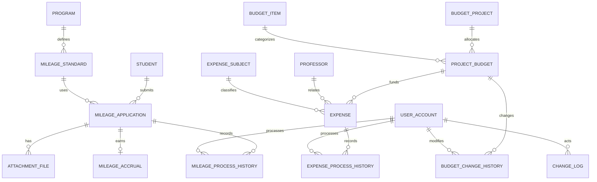

# 마일리지·예산안 및 지출 관리 — 지선 담당 작성본

작성 기준: 확정된 팀 보고서 목차 1~8장
문서 정리일: 2026-10-27 / 담당 단독 검증일: 2026-10-24 / main 통합 실행 확인일: 2026-10-27

이 문서는 팀 보고서의 해당 번호에 옮겨 넣을 담당 작성본이다. 공통 사용자·학생·프로그램·교수·로그는 외부 참조 대상으로만 설명한다.
팀원 담당인3.1~3.3,3.6,6.1~6.2,6.5,7.2,7.5의 본문은 작성하지 않았다. 이 보고서는 지선 담당 구현을 설명하며, 전체 통합 실행 결과와 남은 보완 사항은 별도 통합 검증 문서에 기록한다.
아래 업무 정책은 현재 담당 코드의 구현안이며, 팀 정책 또는 공통 구조가 달라지면 함께 수정한다.


> 검증 범위 안내: 아래 17개 테이블·57개 검사는 2026-10-24 지선 단독 검증 기록이다. 이후 2026-10-27 main 5370069 통합본을 별도 빈 계정에서 실행해 131개 검사가 통과했다. 통합 실행 성공과 보류된 업무 규칙 보완은 구분한다. [최신 통합 검증 및 보완 요청](통합검증및보완요청.md), [SQL Developer 실행 원문](../verification/team-main-5370069-sqldeveloper.txt)을 참조한다.
## 1. 설계 보완 및 변경 이력

### 1.1 기존 설계 및 피드백 검토

PBL1의 마일리지 설계는 프로그램·부여기준·신청·적립·처리이력·증빙을 분리하고, 예산 설계는 사업·예산항목·사업예산·지출·이력을 분리하는 구조였다.
PBL2에서는 이 구조를 Oracle에서 실행 가능한 DDL과 PL/SQL로 구현하였다.
기존 보고서에서 적립 테이블명이 혼용되고 잔액 산식의 기준이 달랐으며, 중복 신청·회수·한도 초과 처리 정책이 미정인 부분을 보완하였다.
실제1차 발표 피드백은 전달받지 않았으므로 피드백을 반영했다고 임의로 기재하지 않았다.

### 1.2 변경 전·후 구조와 변경 이유

| 대상 | 기존 보고서 | PBL2 보완 | 이유 |
|---|---|---|---|
| 적립 명칭 | MILEAGE_EARNING / MILEAGE_ACCRUAL 혼용 | MILEAGE_ACCRUAL 통일 | ERD·DDL·조회 일치 |
| 중복 신청 | 추가 확인 필요 | UNIQUE(student_id, standard_id) | 같은 기준 중복 적립 방지 |
| 취소·회수 | 세부 정책 미정 | 대기 취소·승인 전액 회수, 종료 후 재신청 없음 | 상태 전이 명확화 |
| 적립 유효 여부 | 적립 테이블에 명시 상태 없음 | ACTIVE / REVOKED 추가 | 회수 원본 보존과 집계 분리 |
| 예산액 | 최초예산·한도만 존재 | current_amount 추가 | 변경 후 예산과 최초 편성액 구분 |
| 잔액 | 최초예산/한도 기준 혼재 | 현재예산 잔액과 한도 잔여액 분리 | 지표 해석 통일 |
| 지출 처리이력 | 교수 ID 중심, 처리자 누락 | processor_id 사용자 FK와 전후 상태 | 실제 승인·취소한 사람 추적 |
| 상태 기본값 | 제출/승인대기 등 혼용 | PENDING 등 영문 코드 통일 | CHECK·조회·처리 일치 |
| 학생인건비 | 확장 엔터티 제시, 구현 미정 | 예산항목 구현, 지급 상세 확장 보류 | PBL2 핵심 검증에 집중 |
| 공통 구조 | 전체 사용자·역할·학과 설계 | 최소 fixture로 단독 검증 | 통합 완료로 오인하지 않도록 분리 |

관련 요구사항은 승인된 유효 적립만 집계(Q05~Q06), 대기 신청 조회(Q07), 사업·항목별 예산 현황(Q08), 교수·주체별 승인 지출(Q09), 변경·승인 로그(Q12)이다.
명칭·상태·산식을 통일하고 신청·지출 상태와 이력을 분리하여 이 요구사항을 구현하였다.

### 1.3 업무 처리 정책 및 설계 가정

#### 마일리지 관리

1. 프로그램과 부여기준을 분리한다. 기준은 `(프로그램, 참여/입상)` 조합당 하나다.
2. 동일 학생·동일 기준 신청은 전 상태에 걸쳐 한 건만 허용한다. 참여와 입상은 다른 기준이므로 각각 신청할 수 있다.
3. 반려·취소 후 같은 기준으로 다시 신청하는 기능은 이번 구현에서 제공하지 않는다. 재신청을 허용하려면 신청 차수/유효 신청 유일성 정책을 변경해야 한다.
4. 신청 시 기준 점수를 `applied_mileage`에 복사한다. 이후 기준이 바뀌어도 이미 신청한 점수는 변하지 않는다.
5. 마일리지는 0 이상의 정수이며 0점 기준도 허용한다. 음수는 CHECK로 거부한다.
6. 첨부는 신청당 0개 이상 여러 개를 허용한다. 실제 파일은 저장하지 않고 파일명·가상 경로·등록시각만 관리한다. 필수 첨부 여부 심사는 업무 검토로 두며 첨부 없는 신청을 DB가 자동 차단하지는 않는다.
7. 대기에서 승인하면 신청상태·실제 적립·처리이력·공통로그를 한 트랜잭션에 반영한다. 신청 하나당 적립은 UNIQUE로 한 건이다.
8. 회수는 승인 건에 대한 전액 회수만 허용한다. 적립 원본은 보존하고 `REVOKED`로 바꾼다. 부분 회수는 제외한다.
9. 누적값은 저장하지 않는다. 신청 `APPROVED`이면서 적립 `ACTIVE`인 점수만 SUM한다. 학생 전체를 LEFT JOIN하여 미적립 학생도 0점으로 표시한다.
10. 프로그램별 기간 조회는 **최초 승인일 `approved_at`**을 사용한다. 기간은 `[시작일 00:00, 종료일미포함 00:00)`이다.
11. 기간 조회도 현재 유효한 승인 적립을 대상으로 한다. 나중에 회수되면 과거 승인월 조회에서도 제외한다. 특정 과거 시점의 잔액 복원은 별도 이력 집계가 필요하며 현재 제공하지 않는다.

| 현재 | 허용 다음 상태 | 처리자 |
|---|---|---|
| PENDING | APPROVED / REJECTED | 마스터 |
| PENDING | CANCELLED | 본인 또는 마스터 |
| APPROVED | REVOKED | 마스터 |
| REJECTED / CANCELLED / REVOKED | 없음 | 종료 상태 |

이미 승인한 건의 재승인과 NULL/정의되지 않은 상태 전이는 거부한다.
승인자는 최초 승인자로 보존하며 회수 처리자는 처리이력에서 확인한다.

#### 예산안 및 지출 관리

1. 항목은 인건비, 학생인건비, 연구장비시설비, 연구활동비, 연구재료비, 연구수당, 간접비 7개 기준정보를 사용한다.
2. 같은 사업·항목의 예산은 한 건만 배정한다. 사업과 항목 간 관계는 `PROJECT_BUDGET`으로 연결한다.
3. `initial_amount`는 최초 편성액, `current_amount`는 변경 후 현재 확정예산, `spending_limit`은 실제 승인 가능한 상한이다. 최초예산은 변경 프로시저에서 수정하지 않는다.
4. 금액은 NUMBER(15,2), 단위 원이다. 예산·한도는 0 이상, 지출은 0 초과다. 한도는 현재 확정예산보다 클 수 없다.
5. 지출주체는 산학협력·전공·융합으로 분류한다. 교수·주체별 별도 배정예산은 없으며 지출 합계만 구분한다.
6. 일반관리자와 마스터는 확정예산에 지출을 대기로 등록한다. 한도 검사는 등록 시점이 아닌 **승인 시점**에 수행한다.
7. 승인 시 기존 승인 지출 합계에 이번 금액을 더해 한도와 비교한다. 같으면 승인, 초과하면 오류로 차단한다. 대기·반려·취소는 합계에 포함하지 않는다.
8. 승인한 지출을 취소할 때 원본을 삭제하지 않고 상태·이력·로그를 남긴다. 승인 지출 금액을 직접 수정하는 기능은 제공하지 않는다. 잘못된 지출은 취소 후 새로 등록한다.
9. 예산 변경 시 현재예산·한도를 함께 검증하며, 새 한도를 기존 승인 합계 미만으로 낮추는 변경은 차단한다.
10. 승인/예산 변경은 같은 사업예산 행을 `SELECT ... FOR UPDATE`로 잠근다. 패키지 호출 간 경쟁을 줄이기 위한 구현이며 2세션 동시 승인 시연은 이번 검증에 포함하지 않는다.
11. 학생인건비는 예산항목으로 구현한다. 학생별·교수별·월별 지급 상세 테이블은 이번 범위에서 제외하고 후속 확장 대상으로 둔다. 확장 시 일반 지출과 지급상세를 연결해 이중 합산을 방지해야 한다.

| 지표 | 산식 |
|---|---|
| 승인 지출 | 현재 APPROVED 지출의 금액 합계 |
| 예산 잔액 | 현재 확정예산 − 승인 지출 |
| 한도 잔여액 | 지출한도 − 승인 지출 |
| 집행률 | 승인 지출 ÷ 현재 확정예산 × 100, 소수 둘째 자리 반올림 |
| 0원 예산 집행률 | 0%로 표시 |

현재예산과 한도가 다를 수 있으므로 예산 잔액과 승인 가능한 한도 잔여액을 별도로 표시한다.
누적지출·잔액·집행률은 상세 지출에서 조회 시 계산하며 저장하지 않는다.

| 현재 | 허용 다음 상태 |
|---|---|
| PENDING | APPROVED / REJECTED / CANCELLED |
| APPROVED | CANCELLED |
| REJECTED / CANCELLED | 없음 |

담당 처리에서 일반관리자는 지출을 등록할 수 있고, 승인·반려·회수·예산 변경은 마스터관리자만 가능하도록 하였다.
학생은 본인 마일리지를 신청하고 본인의 대기 신청을 취소할 수 있다. 단, 실제 로그인 신원을 인증하는 기능은 제외하며 세부 한계는8.3에 기재하였다.

## 2. 최종 ERD

### 2.1 최종 관계 구조

아래는 전체 ERD 중 담당 부분의 관계이다. STUDENT·USER_ACCOUNT·PROGRAM·PROFESSOR·CHANGE_LOG는 공통 테이블을 참조하는 외부 연결점이다.



입력자·승인자 FK는 DDL에 추가로 표현되어 있다. `CHANGE_LOG.target_id`는 대상 유형별 여러 테이블을 가리키므로 범용 FK가 아니며 패키지에서 대상과 함께 기록한다.

### 2.2 주요 관계 및 승인·이력 구조

| 관계 | 구조와 의미 |
|---|---|
| 프로그램 → 마일리지기준 | 1:N. 참여·입상 기준을 프로그램 기본정보와 분리 |
| 학생/기준 → 신청 | 각각1:N. 학생+기준 UNIQUE로 같은 기준의 중복 신청 방지 |
| 신청 → 첨부 | 1:0..N. 여러 증빙 메타데이터 허용 |
| 신청 → 적립 | 1:0..1. 승인 전 적립 없음, 승인 후1건 |
| 신청 → 처리이력 | 1:0..N. 승인·반려·취소·회수 과정을 보존 |
| 사업/예산항목 → 사업예산 | 각각1:N. 사업+항목 조합 UNIQUE |
| 사업예산 → 지출 | 1:0..N. 승인 지출만 합산 |
| 교수/지출주체 → 지출 | 각각1:N. 교수별·주체별 지출 분류 |
| 지출 → 처리이력 | 1:0..N. 실제 처리 사용자와 전후 상태 기록 |
| 사업예산 → 예산변경이력 | 1:0..N. 현재예산·한도 전후 값 보존 |

신청·지출에는 현재 상태를 저장하고, 과거 변경 과정은 별도 처리이력에 남긴다. 공통로그에는 대상유형·대상ID·작업·처리자·시각·변경 내용을 함께 기록한다.

## 3. 테이블 정의서

### 3.4 마일리지 관리

담당 테이블은 MILEAGE_STANDARD, MILEAGE_APPLICATION, ATTACHMENT_FILE, MILEAGE_ACCRUAL, MILEAGE_PROCESS_HISTORY의5개이다.
아래 타입·NULL·기본값·제약은 실행한01_schema.sql의 정의이며, PK는 NOT NULL을 포함한다. IDENTITY는 Oracle 자동 번호 생성이다.

#### MILEAGE_STANDARD

| 컬럼 | 설명 | 타입 | NULL 허용 | 키·기본값·제약 |
|---|---|---|---|---|
| standard_id | 마일리지 부여기준 ID | NUMBER(19) | 불가 | PRIMARY KEY |
| program_id | 공통 프로그램 ID | NUMBER(19) | 불가 | NOT NULL REFERENCES program(program_id) |
| participation_award_type | 참여·입상 구분 | VARCHAR2(20 CHAR) | 불가 | NOT NULL CHECK(participation_award_type IN ('PARTICIPATION','AWARD')) |
| grant_mileage | 기준 부여 점수 | NUMBER(9) | 불가 | NOT NULL CHECK(grant_mileage >= 0) |

테이블 단위 제약:

```sql
CONSTRAINT uq_mileage_standard UNIQUE(program_id,participation_award_type)
```

#### MILEAGE_APPLICATION

| 컬럼 | 설명 | 타입 | NULL 허용 | 키·기본값·제약 |
|---|---|---|---|---|
| application_id | 마일리지 신청 ID | NUMBER | 불가 | GENERATED BY DEFAULT ON NULL AS IDENTITY PRIMARY KEY |
| student_id | 공통 학생 ID | NUMBER(19) | 불가 | NOT NULL REFERENCES student(student_id) |
| standard_id | 마일리지 부여기준 ID | NUMBER(19) | 불가 | NOT NULL REFERENCES mileage_standard(standard_id) |
| applied_mileage | 신청 당시 기준 점수 | NUMBER(9) | 불가 | NOT NULL CHECK(applied_mileage >= 0) |
| applied_at | 신청 시각 | TIMESTAMP | 불가 | DEFAULT LOCALTIMESTAMP NOT NULL |
| status | 현재 처리·사용 상태 | VARCHAR2(20 CHAR) | 불가 | DEFAULT 'PENDING' NOT NULL CHECK(status IN ('PENDING','APPROVED','REJECTED','CANCELLED','REVOKED')) |
| approver_id | 최초 승인 사용자 ID | NUMBER(19) | 가능 | REFERENCES user_account(user_id) |
| approved_at | 최초 승인 시각 | TIMESTAMP | 가능 | - |
| memo | 선택 신청 메모 | VARCHAR2(500 CHAR) | 가능 | - |

테이블 단위 제약:

```sql
CONSTRAINT uq_mileage_application UNIQUE(student_id,standard_id)
CONSTRAINT ck_mileage_approval CHECK(
(status IN ('APPROVED','REVOKED') AND approver_id IS NOT NULL AND approved_at IS NOT NULL)
OR (status IN ('PENDING','REJECTED','CANCELLED') AND approver_id IS NULL AND approved_at IS NULL))
```

#### ATTACHMENT_FILE

| 컬럼 | 설명 | 타입 | NULL 허용 | 키·기본값·제약 |
|---|---|---|---|---|
| attachment_file_id | 첨부 메타데이터 ID | NUMBER | 불가 | GENERATED ALWAYS AS IDENTITY PRIMARY KEY |
| application_id | 마일리지 신청 ID | NUMBER | 불가 | NOT NULL REFERENCES mileage_application(application_id) |
| file_name | 증빙 파일명 | VARCHAR2(255 CHAR) | 불가 | NOT NULL |
| storage_path | 가상 저장 경로 | VARCHAR2(500 CHAR) | 불가 | NOT NULL |
| uploaded_at | 첨부 등록 시각 | TIMESTAMP | 불가 | DEFAULT LOCALTIMESTAMP NOT NULL |

#### MILEAGE_ACCRUAL

| 컬럼 | 설명 | 타입 | NULL 허용 | 키·기본값·제약 |
|---|---|---|---|---|
| accrual_id | 실제 적립 ID | NUMBER | 불가 | GENERATED ALWAYS AS IDENTITY PRIMARY KEY |
| application_id | 마일리지 신청 ID | NUMBER | 불가 | NOT NULL UNIQUE REFERENCES mileage_application(application_id) |
| earned_mileage | 실제 적립 점수 | NUMBER(9) | 불가 | NOT NULL CHECK(earned_mileage >= 0) |
| earned_at | 적립 시각 | TIMESTAMP | 불가 | DEFAULT LOCALTIMESTAMP NOT NULL |
| status | 현재 처리·사용 상태 | VARCHAR2(10 CHAR) | 불가 | DEFAULT 'ACTIVE' NOT NULL CHECK(status IN ('ACTIVE','REVOKED')) |

#### MILEAGE_PROCESS_HISTORY

| 컬럼 | 설명 | 타입 | NULL 허용 | 키·기본값·제약 |
|---|---|---|---|---|
| process_history_id | 마일리지 처리이력 ID | NUMBER | 불가 | GENERATED ALWAYS AS IDENTITY PRIMARY KEY |
| application_id | 마일리지 신청 ID | NUMBER | 불가 | NOT NULL REFERENCES mileage_application(application_id) |
| old_status | 처리 전 상태 | VARCHAR2(20 CHAR) | 불가 | NOT NULL CHECK(old_status IN ('PENDING','APPROVED','REJECTED','CANCELLED','REVOKED')) |
| process_status | 처리 후 상태 | VARCHAR2(20 CHAR) | 불가 | NOT NULL CHECK(process_status IN ('APPROVED','REJECTED','CANCELLED','REVOKED')) |
| processor_id | 처리 사용자 ID | NUMBER(19) | 불가 | NOT NULL REFERENCES user_account(user_id) |
| processed_at | 처리 시각 | TIMESTAMP | 불가 | DEFAULT LOCALTIMESTAMP NOT NULL |
| process_comment | 처리 사유·의견 | VARCHAR2(500 CHAR) | 불가 | NOT NULL |

### 3.5 예산안 및 지출 관리

담당 테이블은 BUDGET_PROJECT, BUDGET_ITEM, PROJECT_BUDGET, EXPENSE_SUBJECT, EXPENSE, EXPENSE_PROCESS_HISTORY, BUDGET_CHANGE_HISTORY의7개이다.
금액은 원 단위 NUMBER(15,2)로 저장한다. 교수와 사용자 정보는 공통 PK를 참조하며 별도 중복 저장하지 않는다.

#### BUDGET_PROJECT

| 컬럼 | 설명 | 타입 | NULL 허용 | 키·기본값·제약 |
|---|---|---|---|---|
| project_id | 예산사업 ID | NUMBER(19) | 불가 | PRIMARY KEY |
| business_year | 사업연도 | NUMBER(4) | 불가 | NOT NULL |
| business_round | 사업차수 | NUMBER(4) | 불가 | NOT NULL CHECK(business_round > 0) |
| project_name | 사업명 | VARCHAR2(100 CHAR) | 불가 | NOT NULL |
| start_date | 사업 시작일 | DATE | 불가 | NOT NULL |
| end_date | 사업 종료일 | DATE | 불가 | NOT NULL |
| status | 현재 처리·사용 상태 | VARCHAR2(20 CHAR) | 불가 | DEFAULT 'ACTIVE' NOT NULL CHECK(status IN ('ACTIVE','CLOSED')) |

테이블 단위 제약:

```sql
CHECK(end_date >= start_date)
```

#### BUDGET_ITEM

| 컬럼 | 설명 | 타입 | NULL 허용 | 키·기본값·제약 |
|---|---|---|---|---|
| budget_item_id | 예산항목 ID | NUMBER(19) | 불가 | PRIMARY KEY |
| item_code | 예산항목 코드 | VARCHAR2(30 CHAR) | 불가 | NOT NULL UNIQUE |
| item_name | 예산항목명 | VARCHAR2(100 CHAR) | 불가 | NOT NULL UNIQUE |
| is_active | 기준정보 사용 여부 | CHAR(1) | 불가 | DEFAULT 'Y' NOT NULL CHECK(is_active IN ('Y','N')) |

#### PROJECT_BUDGET

| 컬럼 | 설명 | 타입 | NULL 허용 | 키·기본값·제약 |
|---|---|---|---|---|
| project_budget_id | 사업·항목별 배정예산 ID | NUMBER(19) | 불가 | PRIMARY KEY |
| project_id | 예산사업 ID | NUMBER(19) | 불가 | NOT NULL REFERENCES budget_project(project_id) |
| budget_item_id | 예산항목 ID | NUMBER(19) | 불가 | NOT NULL REFERENCES budget_item(budget_item_id) |
| initial_amount | 최초 편성액 | NUMBER(15,2) | 불가 | NOT NULL CHECK(initial_amount >= 0) |
| current_amount | 변경 후 현재 확정예산 | NUMBER(15,2) | 불가 | NOT NULL CHECK(current_amount >= 0) |
| spending_limit | 승인 가능한 지출 상한 | NUMBER(15,2) | 불가 | NOT NULL CHECK(spending_limit >= 0) |
| status | 현재 처리·사용 상태 | VARCHAR2(20 CHAR) | 불가 | DEFAULT 'CONFIRMED' NOT NULL CHECK(status IN ('DRAFT','CONFIRMED','CLOSED')) |
| input_user_id | 최초 입력 사용자 ID | NUMBER(19) | 불가 | NOT NULL REFERENCES user_account(user_id) |
| input_at | 입력 시각 | TIMESTAMP | 불가 | DEFAULT LOCALTIMESTAMP NOT NULL |

테이블 단위 제약:

```sql
CONSTRAINT uq_project_budget UNIQUE(project_id,budget_item_id)
CHECK(spending_limit <= current_amount)
```

#### EXPENSE_SUBJECT

| 컬럼 | 설명 | 타입 | NULL 허용 | 키·기본값·제약 |
|---|---|---|---|---|
| expense_subject_id | 지출주체 ID | NUMBER(19) | 불가 | PRIMARY KEY |
| subject_name | 산학협력·전공·융합 구분명 | VARCHAR2(100 CHAR) | 불가 | NOT NULL UNIQUE |
| is_active | 기준정보 사용 여부 | CHAR(1) | 불가 | DEFAULT 'Y' NOT NULL CHECK(is_active IN ('Y','N')) |

#### EXPENSE

| 컬럼 | 설명 | 타입 | NULL 허용 | 키·기본값·제약 |
|---|---|---|---|---|
| expense_id | 지출 ID | NUMBER | 불가 | GENERATED BY DEFAULT ON NULL AS IDENTITY PRIMARY KEY |
| project_budget_id | 사업·항목별 배정예산 ID | NUMBER(19) | 불가 | NOT NULL REFERENCES project_budget(project_budget_id) |
| professor_id | 공통 교수 ID | NUMBER(19) | 불가 | NOT NULL REFERENCES professor(professor_id) |
| expense_subject_id | 지출주체 ID | NUMBER(19) | 불가 | NOT NULL REFERENCES expense_subject(expense_subject_id) |
| input_user_id | 최초 입력 사용자 ID | NUMBER(19) | 불가 | NOT NULL REFERENCES user_account(user_id) |
| expense_date | 지출일 | DATE | 불가 | NOT NULL |
| detail_item | 지출 상세내역 | VARCHAR2(200 CHAR) | 불가 | NOT NULL |
| expense_amount | 지출금액 | NUMBER(15,2) | 불가 | NOT NULL CHECK(expense_amount > 0) |
| status | 현재 처리·사용 상태 | VARCHAR2(20 CHAR) | 불가 | DEFAULT 'PENDING' NOT NULL CHECK(status IN ('PENDING','APPROVED','REJECTED','CANCELLED')) |
| processor_id | 처리 사용자 ID | NUMBER(19) | 가능 | REFERENCES user_account(user_id) |
| processed_at | 처리 시각 | TIMESTAMP | 가능 | - |

테이블 단위 제약:

```sql
CHECK((status='PENDING' AND processor_id IS NULL AND processed_at IS NULL)
OR (status <> 'PENDING' AND processor_id IS NOT NULL AND processed_at IS NOT NULL))
```

#### EXPENSE_PROCESS_HISTORY

| 컬럼 | 설명 | 타입 | NULL 허용 | 키·기본값·제약 |
|---|---|---|---|---|
| history_id | 지출 처리이력 ID | NUMBER | 불가 | GENERATED ALWAYS AS IDENTITY PRIMARY KEY |
| expense_id | 지출 ID | NUMBER | 불가 | NOT NULL REFERENCES expense(expense_id) |
| old_status | 처리 전 상태 | VARCHAR2(20 CHAR) | 불가 | NOT NULL CHECK(old_status IN ('PENDING','APPROVED','REJECTED','CANCELLED')) |
| process_status | 처리 후 상태 | VARCHAR2(20 CHAR) | 불가 | NOT NULL CHECK(process_status IN ('APPROVED','REJECTED','CANCELLED')) |
| processor_id | 처리 사용자 ID | NUMBER(19) | 불가 | NOT NULL REFERENCES user_account(user_id) |
| processed_at | 처리 시각 | TIMESTAMP | 불가 | DEFAULT LOCALTIMESTAMP NOT NULL |
| reason | 처리·변경 사유 | VARCHAR2(500 CHAR) | 불가 | NOT NULL |

#### BUDGET_CHANGE_HISTORY

| 컬럼 | 설명 | 타입 | NULL 허용 | 키·기본값·제약 |
|---|---|---|---|---|
| change_history_id | 예산 변경이력 ID | NUMBER | 불가 | GENERATED ALWAYS AS IDENTITY PRIMARY KEY |
| project_budget_id | 사업·항목별 배정예산 ID | NUMBER(19) | 불가 | NOT NULL REFERENCES project_budget(project_budget_id) |
| changer_id | 변경 사용자 ID | NUMBER(19) | 불가 | NOT NULL REFERENCES user_account(user_id) |
| old_amount | 변경 전 현재예산 | NUMBER(15,2) | 불가 | NOT NULL |
| new_amount | 변경 후 현재예산 | NUMBER(15,2) | 불가 | NOT NULL |
| old_limit | 변경 전 한도 | NUMBER(15,2) | 불가 | NOT NULL |
| new_limit | 변경 후 한도 | NUMBER(15,2) | 불가 | NOT NULL |
| changed_at | 예산 변경 시각 | TIMESTAMP | 불가 | DEFAULT LOCALTIMESTAMP NOT NULL |
| reason | 처리·변경 사유 | VARCHAR2(500 CHAR) | 불가 | NOT NULL |

## 4. 무결성 제약조건 및 업무 규칙 구현

### 4.1 PK·FK·UNIQUE·NOT NULL·CHECK·기본값

| 구분 | 담당 적용 내용 |
|---|---|
| PK | 기준·신청·적립·증빙·사업·예산·지출·각 이력의 고유 식별 |
| FK | 학생·사용자·프로그램·교수·사업예산·신청·지출의 실제 존재 확인 |
| UNIQUE | 프로그램+참여/입상, 학생+기준, 적립의 신청ID, 사업+예산항목 |
| NOT NULL | 신청 학생·기준·점수·시각·상태, 지출 예산·교수·주체·금액 등 필수값 |
| CHECK | 점수≥0, 지출>0, 예산/한도≥0, 한도≤현재예산, 정의된 상태값, 종료일≥시작일 |
| 상태 메타데이터 | 승인 신청은 승인자/일시 필수, 처리된 지출은 처리자/일시 필수 |
| DEFAULT | 신청·지출 PENDING, 적립 ACTIVE, 처리시각 LOCALTIMESTAMP |

단일 행의 값·범위·참조·중복은 DB 제약조건으로 차단한다. 누적 한도와 승인에 따른 여러 테이블 변경은 프로시저에서 처리한다.

### 4.2 외래키 삭제·수정 정책과 이력 보존

ON DELETE CASCADE와 자동 키 변경 전파를 사용하지 않았다. 자식 행이 참조하는 부모를 삭제하거나 참조 PK를 수정하면 FK가 거부한다.
이미 승인된 신청·적립·지출은 물리적으로 삭제하는 대신 취소·회수 상태와 처리이력으로 남긴다.
최초예산 initial_amount는 예산 변경 프로시저에서 수정하지 않고 current_amount와 spending_limit의 전후 값을 변경이력에 기록한다.
키 삭제·수정이 필요하면 연관 업무와 이력 보존 영향을 먼저 검토한다.

### 4.3 상태 전이·중복 처리·집계 기준

마일리지는 PENDING에서 APPROVED/REJECTED/CANCELLED, APPROVED에서 REVOKED만 허용한다.
지출은 PENDING에서 APPROVED/REJECTED/CANCELLED, APPROVED에서 CANCELLED만 허용한다.
동일 건 재승인과 NULL 상태 전이는 거부한다. 동일 신청의 적립은 application_id UNIQUE로 한 번만 생성한다.
마일리지는 APPROVED+ACTIVE만, 지출은 APPROVED만 집계한다. 누적 마일리지·지출·잔액·집행률은 별도 저장하지 않고 상세에서 계산한다.
기간별 마일리지는 최초 승인일 기준이며 종료일 미포함 조건으로 조회한다.

### 4.4 뷰·프로시저·트리거 등 주요 구현

| 구현 | 기능 |
|---|---|
| V_STUDENT_MILEAGE | 전체 학생을 기준으로 승인된 유효 적립 합계, 미적립0점 |
| V_BUDGET_SUMMARY | 항목별 최초/현재예산·한도·승인 지출·잔액·집행률 |
| PBL_WORKFLOW.submit_mileage | 본인 신청 확인, 신청 당시 기준 점수 보존 |
| PBL_WORKFLOW.process_mileage | 승인·반려·취소·회수, 적립/이력/로그 처리 |
| PBL_WORKFLOW.submit_expense | 일반/마스터관리자의 지출 등록 |
| PBL_WORKFLOW.process_expense | 마스터의 승인·반려·취소와 한도 검증 |
| PBL_WORKFLOW.change_budget | 현재예산·한도 변경과 전후 이력 |
| TEST_FAIL_LOG | 검증 때만 생성하는 로그 실패 유발 트리거, 검증 후 삭제 |

업무 운영을 위한 상시 트리거는 사용하지 않았다. 테스트 트리거와 실제 업무 규칙 구현을 구분한다.

### 4.5 승인 처리 및 트랜잭션 구현

마일리지 승인 시 신청 행을 잠그고 대기 상태를 확인한 뒤 상태 변경·적립 생성·처리이력·공통로그를 함께 반영한다.
지출 승인은 사업예산 행을 먼저 잠근 뒤 지출 행을 확인하고, 기존 승인 합계+이번 금액이 한도 이하일 때만 승인한다.
예산 변경도 같은 예산 행을 잠그고 새 한도가 기존 승인 합계보다 작지 않은지 검사한다. 여러 행 합계 검증을 단순 CHECK만으로 해결했다고 설명하지 않는다.
각 호출은 SAVEPOINT를 설정하고 오류 시 해당 호출 변경을 ROLLBACK TO로 복구한 뒤 오류를 다시 전달한다.
패키지는 COMMIT하지 않으며, 여러 호출로 구성된 업무 전체의 COMMIT/ROLLBACK은 호출자가 결정한다.

## 5. 데이터베이스 구축 및 테스트 데이터 입력

### 5.1 DBMS·버전 및 실행 환경

Oracle AI Database 26ai Free 23.26.3.0.0, SQL Developer26.2를 사용하였다. DB는 WSL2 Ubuntu에서 Oracle 공식 컨테이너로 실행하였다.
자동 검증은 SQL*Plus, 사용자 실행 확인은 SQL Developer에서 수행하였다. 문자셋은 AL32UTF8, 세션 시간대는+09:00이다.

### 5.2 테이블 생성·삭제·데이터 입력 순서

생성은 공통 참조 테이블 → 마일리지기준/사업/예산항목/지출주체 → 신청/사업예산 → 첨부/적립/지출 → 처리·변경이력 순으로 진행한다.
입력도 기준정보와 공통 데이터부터 진행한다. 뷰·패키지는 참조 대상 생성 후 만든다.
삭제는 자식에서 부모의 역순으로 진행하며 다른 파트의 FK 연결을 먼저 확인한다.

### 5.3 가상 테스트 데이터 구성

| 데이터 | 실제 규모·구성 |
|---|---|
| 학생·계정 | 가상학생 10명, 학생계정10 + 일반관리자1 + 마스터1 |
| 프로그램·기준 | 프로그램3개, 참여/입상 기준6개 |
| 마일리지 신청 | 12건: 승인6, 대기2, 반려2, 취소1, 회수1 |
| 적립 | 총7건: ACTIVE6, REVOKED1 |
| 증빙 메타데이터 | 13건, 대기 신청 하나에 첨부2건 |
| 예산 | 사업1개, 항목7개, 사업예산7건 |
| 교수·지출주체 | 교수3명, 산학협력·전공·융합3개 |
| 지출 | 12건: 승인6, 대기4, 반려1, 취소1 |
| 이력·로그 | 마일리지 처리11, 지출 처리9, 예산변경1, 공통로그45 |

공통 fixture에는 학과·학년·역할권한 연결 등 전체 공통 설계가 없다. 팀 전체 학생·권한 요구를 충족하는 데이터로 오인하지 않으며 통합 시 담당자 시드로 교체한다.

### 5.4 빈 DB에서 테이블 생성 및 정상 데이터 삽입 결과

전용 실습 스키마의 테이블 수0개를 확인한 뒤 run_demo.sql을 실행하였다.
공통 참조를 대신한 임시5개와 담당12개, 총17개 테이블 생성 및 정상 데이터 입력이 성공하였다.
뷰2개와 패키지 명세/본문은 VALID, USER_ERRORS는0건이었다. 담당 데이터는 프로그램3개·신청12건·사업1개·항목7개·교수3명·지출12건이다.
검증 종료 후 테스트 트리거는 삭제되었고 마일리지810점·승인 지출1,500,000원의 시드 집계가 유지되었다.
실행 원문은 verification/oracle-validation.txt에 보관하였다. 이 결과는 팀 통합 스키마의 테이블 수나 전체 기능 완료를 뜻하지 않는다.

### 5.5 실행·재실행·초기화 방법

처음에는 빈 실습 계정에서 run_demo.sql을 파일로 열고 F5로 실행한다. 내부 순서는 공통 임시DDL → 담당DDL → 정상 시드 → 조회 → 검증이다.
이후03_queries.sql,04_tests.sql,05_workflow_examples.sql만 시드 상태에서 개별 실행할 수 있다. 생성/시드 파일은 데이터가 있는 계정에 다시 실행하지 않는다.
초기화가 필요하면 본인이 만든 전용 실습 스키마인지 확인한 후 계정을 재생성하거나 다른 빈 계정을 사용한다. 공동 스키마를 임의로 삭제하지 않는다.
Oracle DDL은 암묵적으로 COMMIT되므로 미확정 업무 작업을 먼저 정리한다.
SQL*Plus 클라이언트는 NLS_LANG=AMERICAN_AMERICA.AL32UTF8, SQL Developer 파일 인코딩은 UTF-8을 사용한다.
오류 입력은04_tests.sql에 분리했고, 예상 오류는 SQLCODE로 검사한다. 실패 시 남을 수 있는 TEST_FAIL_LOG는 원인을 확인한 뒤 정리한다.

## 6. 필수 조회 및 집계 SQL 검증

### 6.3 마일리지 누적·승인 내역 및 대기 목록 — Q05~Q07

| 요구 | 목적 | 입력 예시 | 판단 기준 |
|---|---|---|---|
| Q05 | 학생 누적 점수 | 전체 또는 student_id=1 | 현재 APPROVED+ACTIVE, 미적립0점 |
| Q06 | 프로그램·기간별 내역/합계 | 2026-10-01 이상~2026-11-01 미만 | 최초 승인일, 현재 유효 승인 |
| Q07 | 관리자 검토 대기 목록 | PENDING 전체 | 신청자·프로그램·증빙, 신청당1행 |

#### Q05학생 누적 마일리지

학생1은 참여100+입상300=400, 학생2는50+80=130, 학생3은80, 학생4는200이다.
학생5~10은 대기·반려·취소·회수 또는 무신청으로 모두0이다. 합계는400+130+80+200=810이다.
실제 결과도 각각400,130,80,200,0,0,0,0,0,0, 총810으로 일치했다.

#### Q06 프로그램·기간별 승인 마일리지

기간은 2026-10-01 이상 2026-11-01 미만, 기준은 최초 승인일이다.

| 프로그램 | 예상 계산 | 예상 | 실제 |
|---|---|---:|---:|
| 가상 해커톤 | 100+300, 회수300 제외 | 400 | 400 |
| 가상 SQL 특강 | 승인50, 반려·대기 제외 | 50 | 50 |
| 가상 PBL 발표회 | 80+200+80, 취소 제외 | 360 | 360 |

#### Q07 승인대기 신청

학생5의100점 신청과 학생9의50점 신청, 총2건이다. 증빙은 각각2개와1개다.
첨부를 신청 단위로 먼저 묶어 여러 첨부가 있어도 신청 행이 늘어나지 않게 했다. 실제 조회도2행이다.

실행 SQL의 입력 예시:

```sql
DEFINE student_id = 1
DEFINE from_date = '2026-10-01'
DEFINE to_date_exclusive = '2026-11-01'
-- Q05 전체 학생 누적 유효 마일리지. 예상: 1=400,2=130,3=80,4=200,5~10=0,총810.
SELECT * FROM v_student_mileage ORDER BY student_id;
-- Q05 특정 학생 예시. ID 필터는 인증/접근통제 자체가 아니며 호출자의 신원 연계가 필요.
SELECT * FROM v_student_mileage WHERE student_id=&student_id;

-- Q06 프로그램별·기간별 승인 적립 상세. 기준일은 최초 승인일 approved_at.
-- [시작일,종료일미포함), 현재 APPROVED + ACTIVE만 포함. 증빙/이력은 합계 JOIN에서 제외.
SELECT p.program_id,p.detail_program_name,a.application_id,a.student_id,
 a.approved_at,c.earned_mileage
FROM program p JOIN mileage_standard ms ON ms.program_id=p.program_id
JOIN mileage_application a ON a.standard_id=ms.standard_id
JOIN mileage_accrual c ON c.application_id=a.application_id
WHERE a.status='APPROVED' AND c.status='ACTIVE'
 AND a.approved_at>=TO_DATE('&from_date','YYYY-MM-DD')
 AND a.approved_at<TO_DATE('&to_date_exclusive','YYYY-MM-DD')
ORDER BY p.program_id,a.application_id;
-- Q06 합계 예상: 프로그램1=400,2=50,3=360. 승인 내역 없는 프로그램도 0으로 표시.
SELECT p.program_id,p.detail_program_name,NVL(x.total_mileage,0) total_mileage,NVL(x.approval_count,0) approval_count
FROM program p LEFT JOIN (
 SELECT ms.program_id,SUM(c.earned_mileage) total_mileage,COUNT(*) approval_count
 FROM mileage_standard ms JOIN mileage_application a ON a.standard_id=ms.standard_id
 JOIN mileage_accrual c ON c.application_id=a.application_id
 WHERE a.status='APPROVED' AND c.status='ACTIVE'
 AND a.approved_at>=TO_DATE('&from_date','YYYY-MM-DD')
 AND a.approved_at<TO_DATE('&to_date_exclusive','YYYY-MM-DD')
 GROUP BY ms.program_id
) x ON x.program_id=p.program_id ORDER BY p.program_id;

-- Q07 대기 신청 + 증빙 메타데이터. 신청 단위 목록: 예상 2건, 첨부 수 2/1.
SELECT a.application_id,s.student_id,s.student_name,p.detail_program_name,
 ms.participation_award_type,a.applied_mileage,a.applied_at,
 NVL(f.file_count,0) file_count,f.file_names,f.storage_paths
FROM mileage_application a JOIN student s ON s.student_id=a.student_id
JOIN mileage_standard ms ON ms.standard_id=a.standard_id
JOIN program p ON p.program_id=ms.program_id
LEFT JOIN (
 SELECT application_id,COUNT(*) file_count,
 LISTAGG(file_name, '; ' ON OVERFLOW TRUNCATE) WITHIN GROUP(ORDER BY attachment_file_id) file_names,
 LISTAGG(storage_path, '; ' ON OVERFLOW TRUNCATE) WITHIN GROUP(ORDER BY attachment_file_id) storage_paths
 FROM attachment_file GROUP BY application_id
) f ON f.application_id=a.application_id
WHERE a.status='PENDING' ORDER BY a.applied_at,a.application_id;
```

첨부는 신청별로 먼저 묶어 복수 증빙 때문에 신청이나 점수 합계가 늘어나지 않도록 했다.

### 6.4 예산·지출·잔액·집행률 — Q08~Q09

Q08은 전체 및 project_id=1의 사업예산을 조회한다. Q09는 같은 사업의 승인 지출을 교수별·주체별로 합산한다.
지출을 사업예산별로 먼저 합산한 뒤 LEFT JOIN하여 무지출 항목도 포함한다. 0원 예산은 CASE로 나눗셈을 피한다.

#### Q08항목별 예산

금액 단위 원, 집행률 단위 %. 최초와 현재예산은 연구활동비 외에는 동일하다.
연구활동비는 최초1,000,000원에서 현재1,100,000원으로 변경했고 한도는800,000원이다.

| 항목 | 현재예산 | 한도 | 승인 지출 예상=실제 | 예산 잔액 예상=실제 | 집행률 예상=실제 |
|---|---:|---:|---:|---:|---:|
| 인건비 | 1,000,000 | 1,000,000 | 300,000 | 700,000 | 30 |
| 학생인건비 | 2,000,000 | 2,000,000 | 600,000 | 1,400,000 | 30 |
| 연구장비시설비 | 1,500,000 | 1,500,000 | 500,000 | 1,000,000 | 33.33 |
| 연구활동비 | 1,100,000 | 800,000 | 100,000 | 1,000,000 | 9.09 |
| 연구재료비 | 500,000 | 500,000 | 0 | 500,000 | 0 |
| 연구수당 | 300,000 | 300,000 | 0 | 300,000 | 0 |
| 간접비 | 0 | 0 | 0 | 0 | 0 |

승인 합계는300,000+600,000+500,000+100,000=1,500,000원이다.
연구활동비의 예산 잔액은1,000,000원이나 한도 잔여액은700,000원으로, 두 지표를 구분한다.
간접비0원은 CASE로 나누기를 피하고 집행률0%를 반환한다.

#### Q09 교수·지출주체별 승인 지출

| 집계 단위 | 예상 계산 | 예상=실제 |
|---|---|---:|
| 교수A | 200,000+400,000 | 600,000 |
| 교수B | 100,000+500,000 | 600,000 |
| 교수C | 200,000+100,000 | 300,000 |
| 산학협력 | 200,000+500,000 | 700,000 |
| 전공 | 100,000+400,000 | 500,000 |
| 융합 | 200,000+100,000 | 300,000 |

교수별·주체별 합계 각각1,500,000원으로 사업 승인 지출 합계와 일치한다.
교수/주체에는 별도 예산을 배정하지 않으므로 이 합계를 교수별 잔액으로 해석하지 않는다.

실행 SQL:

```sql
DEFINE project_id = 1
-- Q08 전체 사업 예산 현황. 승인 지출 사전집계 후 JOIN. 금액 단위 원, 집행률 %.
SELECT * FROM v_budget_summary ORDER BY project_id,project_budget_id;
-- Q08 특정 사업: 최초예산/현재예산/한도/예산잔액/한도잔여액을 구분.
SELECT * FROM v_budget_summary WHERE project_id=&project_id ORDER BY project_budget_id;

-- Q09 교수별 승인 지출: 예상 교수1=600000,2=600000,3=300000.
SELECT p.professor_id,p.name,NVL(x.approved_amount,0) approved_amount
FROM professor p LEFT JOIN (
 SELECT e.professor_id,SUM(e.expense_amount) approved_amount FROM expense e
 JOIN project_budget b ON b.project_budget_id=e.project_budget_id
 WHERE e.status='APPROVED' AND b.project_id=&project_id GROUP BY e.professor_id
) x ON x.professor_id=p.professor_id ORDER BY p.professor_id;
-- Q09 지출주체별: 산학협력=700000,전공=500000,융합=300000.
SELECT s.expense_subject_id,s.subject_name,NVL(x.approved_amount,0) approved_amount
FROM expense_subject s LEFT JOIN (
 SELECT e.expense_subject_id,SUM(e.expense_amount) approved_amount FROM expense e
 JOIN project_budget b ON b.project_budget_id=e.project_budget_id
 WHERE e.status='APPROVED' AND b.project_id=&project_id GROUP BY e.expense_subject_id
) x ON x.expense_subject_id=s.expense_subject_id ORDER BY s.expense_subject_id;
-- Q09 교수×주체 교차 내역. 각 교수의 배정예산/잔액으로 해석하지 않는다.
SELECT e.professor_id,p.name,e.expense_subject_id,s.subject_name,SUM(e.expense_amount) approved_amount
FROM expense e JOIN professor p ON p.professor_id=e.professor_id
JOIN expense_subject s ON s.expense_subject_id=e.expense_subject_id
JOIN project_budget b ON b.project_budget_id=e.project_budget_id
WHERE e.status='APPROVED' AND b.project_id=&project_id
GROUP BY e.professor_id,p.name,e.expense_subject_id,s.subject_name ORDER BY e.professor_id,e.expense_subject_id;
```

### 6.6 대상별 변경·승인 로그 — Q12

아래 내용은 전체 Q12 중 마일리지·예산·지출 담당 대상의 로그이다.

#### Q12변경·승인 로그

마일리지·지출의 신청과 승인·반려·취소·회수, 예산변경을 기록했다. 총45건이다.
대상유형/대상ID, 작업, 처리자, 처리시각, 변경 전후 상태 또는 금액, 사유를 조회한다.
범용로그의 target_id는 여러 유형을 참조하므로 일반 FK가 없으며 대상유형과 함께 해석한다.

실행 SQL:

```sql
DEFINE target_type = 'MILEAGE'
DEFINE target_id = 1
-- Q12 담당 영역의 대상별 로그. 날짜는 로그 처리시각 processed_at.
-- 최초 시드의 마일리지 신청/승인/지출/예산 변경은 실제 실행시각으로 기록된다.
SELECT l.log_id,l.target_type,l.target_id,l.action_type,l.actor_user_id,u.login_id,
 l.processed_at,l.old_value,l.new_value,l.reason
FROM change_log l JOIN user_account u ON u.user_id=l.actor_user_id
WHERE l.target_type='&target_type' AND l.target_id=&target_id ORDER BY l.processed_at,l.log_id;
-- 전체 담당 영역 로그 예시
SELECT target_type,action_type,COUNT(*) log_count FROM change_log
WHERE target_type IN ('MILEAGE','EXPENSE','BUDGET') GROUP BY target_type,action_type ORDER BY target_type,action_type;
```

## 7. 업무 처리 및 오류 시나리오 검증

### 7.1 중복·외래키·점수 및 금액 범위 검증

| 입력·시도 | 예상 결과 | 실제 결과 | 구현 방법 |
|---|---|---|---|
| 동일 학생·기준 중복 신청 | 거부 | -1, 성공 | 복합 UNIQUE |
| 동일 신청 중복 적립 | 거부 | -1, 성공 | 신청ID UNIQUE |
| 없는 학생·프로그램 참조 | 거부 | -2291, 성공 | FK |
| 음수 마일리지 기준 | 거부 | -2290, 성공 | CHECK |
| 0원/음수 지출 | 거부 | -2290, 성공 | CHECK |
| 정의되지 않은 신청 상태 | 거부 | -2290, 성공 | CHECK |

수작업 예상과 실제 오류코드가 일치하는지 검사했다. 입력 SQL은04_tests.sql에 있으며 정상 시드와 분리하였다.

### 7.3 마일리지 승인·반려 및 이중 적립 방지 검증

| 입력·시도 | 예상 결과 | 실제 결과 | 구현 방법 |
|---|---|---|---|
| 학생5 대기100점 승인 | 누적0→100점, 적립/이력 생성 | 일치, 성공 | process_mileage |
| 승인 적립 전액 회수 | 누적100→0점 | 일치, 성공 | REVOKED 상태 |
| 대기 신청 반려 | 적립0건 | 0건, 성공 | 상태 전이 |
| 이미 승인한 신청 재승인 | 거부 | -20002, 성공 | 현재 상태 검사 |
| 기준 점수999로 변경 후 기존 신청 승인 | 신청 당시100점 적립 | 100점, 성공 | 신청 점수 스냅샷 |
| NULL 상태 처리 | 거부 | -20002, 성공 | 상태 전이 검사 |

SQL Developer 시연에서도 학생5의0→100→0점을 확인했고 끝에 ROLLBACK했다.

### 7.4 지출 승인·반려·무지출 항목 및 한도 초과 검증

| 입력·시도 | 예상 결과 | 실제 결과 | 구현 방법 |
|---|---|---|---|
| 연구활동비 대기50,000원 승인 | 승인 합계100,000→150,000원 | 일치, 성공 | process_expense |
| 위 승인 지출 취소 | 합계150,000→100,000원 | 일치, 성공 | CANCELLED 제외 |
| 반려·대기 지출 집계 | 승인 합계에서 제외 | 일치, 성공 | APPROVED 필터 |
| 연구재료비 승인 지출 없음 | 지출0, 잔액500,000원 | 일치, 성공 | LEFT JOIN/NVL |
| 간접비 예산0 | 집행률0%, 나눗셈 오류 없음 | 일치, 성공 | CASE |
| 기존100,000+대기700,000원 승인 | 한도800,000원과 같으므로 승인 | 한도 잔여0, 성공 | 승인 합계 비교 |
| 그 뒤50,000원 추가 승인 | 거부, 대기 유지 | -20003·PENDING, 성공 | 프로시저+예산행 잠금 |
| 동일 지출 재승인 | 거부 | -20002, 성공 | 상태 전이 검사 |
| 한도를 승인 합계 미만으로 축소 | 거부 | -20003, 성공 | 예산 변경 합계 검사 |
| 현재예산보다 큰 한도 | 거부 | -20007, 성공 | 변경 입력 검사 |

연구활동비 승인 전후 시연에서 예산 잔액은1,000,000→950,000→1,000,000원, 한도 잔여액은700,000→650,000→700,000원이었다.
집행률은9.09→13.64→9.09%로 확인되었다. 시연 끝에 ROLLBACK했다.

### 7.6 역할별 권한 및 다른 학생 데이터 조회 검증

일반관리자/학생 ID로 마일리지 승인 프로시저를 호출하면 -20001, 일반관리자 ID로 예산 변경을 시도해도 -20001로 거부되었다.
다른 학생 명의 마일리지 신청 시 -20001로 거부됨을 확인하였다.
조회 SQL의 학생 ID 제한은 데이터 선택 조건이며 실제 요청자의 신원을 인증하지는 않는다. 같은 소유자 연결에서 다른 actor ID를 전달하거나 직접 DML하는 우회는 차단하지 않았다.
따라서 다른 학생 조회가 실제 로그인 수준에서 차단된 것으로 설명하지 않는다. 인증 신원과 actor의 연결, 실행 전용 DB 계정 및 필요한 뷰/패키지만 부여하는 보호가 필요하다.

### 7.7 승인 처리 실패 시 롤백 및 로그 일관성 검증

TEST_FAIL_LOG 트리거가 로그 입력 시 -20999를 발생시키도록 하여 마일리지 승인·지출 승인·예산 변경 도중 실패를 재현했다.
로그는 상태/적립/처리이력 변경 후 기록되므로 실제로 부분 변경이 일어날 수 있는 시점을 검사한다.
이 실패 검사에서는 테스트 도우미가 먼저 ROLLBACK하지 않고, 프로시저가 복구한 직후 상태를 직접 조회했다.

| 실패 시점 | 확인 항목 | 예상 | 실제 |
|---|---|---|---|
| 마일리지 승인 로그 | 신청 상태·적립·처리이력 | PENDING, 적립0, 이력0 | 일치 |
| 지출 승인 로그 | 지출 상태·처리이력 | PENDING, 이력0 | 일치 |
| 예산 변경 로그 | 현재예산·변경이력 | 기존1,000,000원, 변경이력0 | 일치 |
| 위 실패 후 전체로그 | 로그 건수 | 기존45건 유지 | 45건 |

모든 검사 후 임시 트리거를 삭제했으며 전체 단독 자동검증57개가 통과하였다. 전체 결과는 부록에 기재하였다.

## 8. 구현 결과 및 미구현 범위

### 8.1 구현·검증 결과 요약

담당12개 테이블, 집계 뷰2개와 승인 패키지를 구현했다. 임시 공통 구조를 포함한 빈 실습 스키마 실행과 정상 입력이 성공했고 컴파일 오류는0건이었다.
단독 자동검증57개가 통과하였고 핵심 집계는 유효 마일리지810점, 승인 지출1,500,000원으로 수작업 예상값과 일치하였다.
SQL Developer의 조회·검증·승인 전후 시연에서도 동일한 결과가 확인되었다.

### 8.2 DB 자동 강제 규칙과 검증 SQL의 적용 범위

PK/FK/UNIQUE/NOT NULL/CHECK는 잘못된 단일 행 입력을 DB가 직접 차단한다.
상태 전이·사용자 유형 판단·신청 당시 점수 보존·누적 한도·업무와 로그의 원자성은 PBL_WORKFLOW 경유 시 적용된다.
뷰는 집계 계산을 제공하며 접근통제 자체를 보장하지 않는다. 검증 SQL은 결과를 확인하는 코드이며 운영 규칙을 자동 강제하는 장치와 구분한다.
테이블 소유자가 직접 DML하면 일부 업무 규칙을 우회할 수 있으므로 실제 운영에는 계정 권한 분리가 필요하다.

### 8.3 미구현 범위 및 보완사항

- main 5370069 통합본은 2026-10-27 별도 빈 스키마에서 131개 검사를 통과했다. 학적 변경과 만족도 관련 보완은 별도 문서에 기록했으며, 수정 후 재검증이 필요하다.
- 실제 로그인 신원 연계, actor 사칭 방지, 직접 DML 금지는 미구현이다.
- 동시 승인 경쟁을 위한 예산행 잠금은 구현했으나 다중 세션 시연은 하지 않았다.
- 부분 회수, 반려·취소 후 동일 기준 재신청, 학생인건비 지급상세는 제외하였다.
- 실제 로그인·웹/앱 화면·파일 업로드는 이번 구현 범위에서 제외하였다.
- 지출일의 사업기간 포함, 비활성 교수/주체 사용 금지, 증빙의 실제 존재는 자동 검증하지 않는다.
- 최종 공통 컬럼·FK·역할 구조와 팀 정책이 확정되면 연결 부분 및 테스트 예상값을 조정하고 다시 검증한다.

## 부록. SQL 파일 구성 및 실행 결과 자료

| 파일 | 내용 |
|---|---|
| sql/01_schema.sql | 담당 DDL·뷰·승인 패키지 |
| sql/02_domain_seed.sql | 담당 정상 시드 |
| sql/02_seed.sql | 임시 공통 데이터를 포함한 단독 실습 진입점 |
| sql/03_queries.sql | Q05~Q09 및 담당 Q12 |
| sql/04_tests.sql | 오류·상태 변경·승인·집계·롤백 검증 |
| sql/05_workflow_examples.sql | 승인 전후 시연 |
| sql/run_demo.sql | 빈 실습 스키마에서 전체 재현 |
| sql/fixtures/ | 단독 실습용 최소 공통 구조·데이터 |
| verification/oracle-validation.txt | 전체 생성·조회·검증 실행 원문 |
| verification/workflow-demo.txt | 승인 전후 시연 실행 원문 |

담당 브랜치: https://github.com/bangjinseo/26-2-DBP/tree/codex/mileage-budget-pbl2

### 전체 단독 검증 결과

공통 중복학번/로그인 보조검사를 포함한57개 결과이다. 공통 테이블 최종 정의를 본 담당이 구현했다는 의미는 아니다.

입력 SQL과 구현 방법은 04_tests.sql, 실행 원문은 verification/oracle-validation.txt를 참조한다.
오류코드의 음수는 실패한 검증이 아니라 예상한 DB 거부 결과다.

| 번호 | 검증 | 예상값 | 실제값 | 결과 |
|---|---|---:|---:|---|
| 1 | 전체 학생 누적 마일리지 합계 | 810 | 810 | 성공 |
| 2 | 학생1 누적 마일리지 | 400 | 400 | 성공 |
| 3 | 미신청 학생 마일리지 0점 | 0 | 0 | 성공 |
| 4 | 회수 적립 집계 제외 | 0 | 0 | 성공 |
| 5 | 미적립 학생 수 | 6 | 6 | 성공 |
| 6 | 프로그램1 기간별 승인 마일리지 | 400 | 400 | 성공 |
| 7 | 승인대기 신청 수 | 2 | 2 | 성공 |
| 8 | 한 신청의 복수 증빙 수 | 2 | 2 | 성공 |
| 9 | 예산항목 7개 포함 | 7 | 7 | 성공 |
| 10 | 사업 승인 지출 총액 | 1500000 | 1500000 | 성공 |
| 11 | 승인 지출 없는 항목 잔액 | 500000 | 500000 | 성공 |
| 12 | 0원 예산 집행률 | 0 | 0 | 성공 |
| 13 | 예산 변경 후 잔액 | 1000000 | 1000000 | 성공 |
| 14 | 예산 변경 후 집행률 | 9.09 | 9.09 | 성공 |
| 15 | 교수1 승인 지출 | 600000 | 600000 | 성공 |
| 16 | 산학협력 승인 지출 | 700000 | 700000 | 성공 |
| 17 | 중복 학번 거부 | -1 | -1 | 성공 |
| 18 | 중복 로그인 ID 거부 | -1 | -1 | 성공 |
| 19 | 존재하지 않는 프로그램 FK 거부 | -2291 | -2291 | 성공 |
| 20 | 존재하지 않는 학생 FK 거부 | -2291 | -2291 | 성공 |
| 21 | 음수 마일리지 거부 | -2290 | -2290 | 성공 |
| 22 | 중복 마일리지 신청 거부 | -1 | -1 | 성공 |
| 23 | 중복 적립 생성 거부 | -1 | -1 | 성공 |
| 24 | 0원 지출 거부 | -2290 | -2290 | 성공 |
| 25 | 음수 지출 거부 | -2290 | -2290 | 성공 |
| 26 | 정의되지 않은 상태 거부 | -2290 | -2290 | 성공 |
| 27 | 일반관리자의 승인 거부 | -20001 | -20001 | 성공 |
| 28 | 학생의 승인 거부 | -20001 | -20001 | 성공 |
| 29 | 이미 승인한 신청 재승인 거부 | -20002 | -20002 | 성공 |
| 30 | NULL 상태 전이 거부 | -20002 | -20002 | 성공 |
| 31 | 다른 학생 명의 신청 거부 | -20001 | -20001 | 성공 |
| 32 | 승인 후 100점 반영 | 100 | 100 | 성공 |
| 33 | 승인 처리이력 생성 | 1 | 1 | 성공 |
| 34 | 전액 회수 후 0점 | 0 | 0 | 성공 |
| 35 | 반려 시 적립 미생성 | 0 | 0 | 성공 |
| 36 | 신청 당시 기준 점수 보존 | 100 | 100 | 성공 |
| 37 | 한도와 같은 금액 승인 | 0 | 0 | 성공 |
| 38 | 한도 초과 승인 거부 | -20003 | -20003 | 성공 |
| 39 | 이미 승인한 지출 재승인 거부 | -20002 | -20002 | 성공 |
| 40 | 한도 초과 지출의 대기 유지 | 1 | 1 | 성공 |
| 41 | 지출 승인 후 합계 증가 | 150000 | 150000 | 성공 |
| 42 | 지출 취소 후 합계 복구 | 100000 | 100000 | 성공 |
| 43 | 승인 합계 미만으로 한도 축소 거부 | -20003 | -20003 | 성공 |
| 44 | 예산 초과 한도 설정 거부 | -20007 | -20007 | 성공 |
| 45 | 일반관리자의 예산 변경 거부 | -20001 | -20001 | 성공 |
| 46 | 마일리지 로그 저장 실패 재현 | -20999 | -20999 | 성공 |
| 47 | 마일리지 상태 롤백 | 1 | 1 | 성공 |
| 48 | 마일리지 적립 롤백 | 0 | 0 | 성공 |
| 49 | 마일리지 처리이력 롤백 | 0 | 0 | 성공 |
| 50 | 지출 로그 저장 실패 재현 | -20999 | -20999 | 성공 |
| 51 | 지출 상태 롤백 | 1 | 1 | 성공 |
| 52 | 지출 처리이력 롤백 | 0 | 0 | 성공 |
| 53 | 예산 변경 로그 저장 실패 재현 | -20999 | -20999 | 성공 |
| 54 | 예산 금액 롤백 | 1000000 | 1000000 | 성공 |
| 55 | 예산 변경이력 롤백 | 0 | 0 | 성공 |
| 56 | 실패 후 로그 수 유지 | 45 | 45 | 성공 |
| 57 | 신청·적립 상태 일관성 | 0 | 0 | 성공 |
