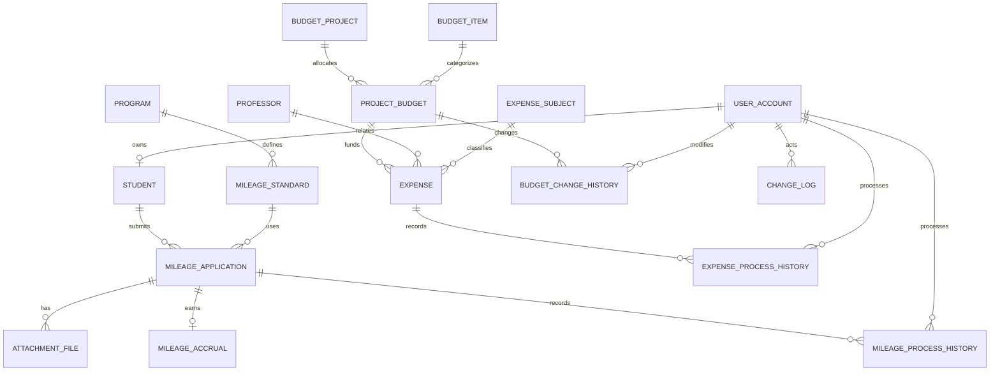

# PBL 미션2 마일리지·예산안 및 지출 관리 담당 보고서

담당: 지선
문서 정리일: 2026-10-25
구현·단독 검증일: 2026-10-24
상태: 담당 기능 단독 구현·검증 완료, 팀 공통 구조 연결 및 통합 검증 예정

## 1. 목적과 담당 범위

PBL1의 마일리지·예산 및 지출 모델을 Oracle DB에 구현하고 정상·오류·경계값 데이터와 SQL 실행 결과로 설계의 타당성을 검증하였다.
담당 구현은 마일리지5개 테이블과 예산·지출7개 테이블, 집계 뷰2개, 승인 처리 패키지1개이다.
필수 조회 중 Q05~Q09와 담당 대상의 Q12를 구현하였다.
학생정보 변경·TOPCIT·만족도 업무 및 공통 테이블 최종안은 본 담당 범위에서 제외한다.
학생·사용자·프로그램·교수·공통로그는 외부 공통 구조로 참조한다. 단독 검증의 최소 임시 공통 테이블5개는 팀 공통 최종본을 의미하지 않는다.

## 2. 실행 환경과 재현

- 검증일: 2026-10-24, 한국 시각 기준.
- DBMS: Oracle AI Database 26ai Free 23.26.3.0.0, AL32UTF8.
- 설치 형태: WSL2 Ubuntu 24.04의 Oracle 공식 컨테이너. SQL Developer 26.2에서 같은 DB에 접속 가능.
- 실행 도구: SQL*Plus. UTF-8 클라이언트, 세션 시간대 +09:00.
- 최종 실행 계정: PBL2. 실행 전 이 계정의 업무 테이블이 0개임을 확인했다.
- run_demo.sql 전체 실행 후 57개 검사 통과, ALL TESTS PASSED 및 DEMO COMPLETED 확인.
- 공통 fixture 5개 + 담당 테이블 12개 = 총 17개. 뷰 2개와 패키지 명세/본문 모두 VALID, USER_ERRORS 0건.
- 승인 전후 시연 파일도 실행했고 마지막 ROLLBACK 뒤 마일리지 810점, 승인 지출 1,500,000원으로 복원됨을 확인했다.

생성은 임시 공통 DDL → 담당 DDL → 임시 공통 시드 → 담당 시드 → 조회 → 검증 순으로 실행했다.
생성/입력은 기준정보에서 자식 업무·이력 순으로, 삭제는 연결된 업무를 확인한 뒤 역순으로 수행한다.
Oracle DDL은 암묵적으로 커밋된다. 새 빈 전용 실습 스키마에서 run_demo.sql을 F5 실행하며, DDL과 시드를 이미 데이터가 있는 공동 스키마에 중복 실행하지 않는다.
조회·검증·시연은 시드 상태에서 개별 재실행할 수 있다. SQL*Plus는 NLS_LANG=AMERICAN_AMERICA.AL32UTF8, SQL Developer 파일은 UTF-8을 사용한다.

## 3. PBL1 대비 설계 보완

| 대상 | 기존 보고서 | PBL2 보완 | 이유 |
|---|---|---|---|
| 적립 명칭 | MILEAGE_EARNING / MILEAGE_ACCRUAL 혼용 | MILEAGE_ACCRUAL 통일 | ERD·DDL·조회 일치 |
| 중복 신청 | 추가 확인 필요 | UNIQUE(student_id, standard_id) | 같은 기준 중복 적립 방지 |
| 취소·회수 | 세부 정책 미정 | 대기 취소·승인 전액 회수, 종료 후 재신청 없음 | 상태 전이 명확화 |
| 적립 유효 여부 | 적립 테이블에 명시 상태 없음 | ACTIVE / REVOKED 추가 | 회수 원본 보존과 집계 분리 |
| 예산액 | 최초예산·한도만 존재 | current_amount 추가 | 변경 후 예산과 최초 편성액 구분 |
| 잔액 | 최초예산/한도 기준 혼재 | 현재예산 잔액과 한도 잔여액 분리 | 지표 해석 통일 |
| 지출 처리이력 | 교수 ID 중심, 처리자 누락 | processor_id 사용자 FK와 전후 상태 | 실제 승인·취소한 사람 추적 |
| 상태 기본값 | 제출/승인대기 등 혼용 | PENDING 등 영문 코드 통일 | CHECK·조회·처리 일치 |
| 학생인건비 | 확장 엔터티 제시, 구현 미정 | 예산항목 구현, 지급 상세 확장 보류 | PBL2 핵심 검증에 집중 |
| 공통 구조 | 전체 사용자·역할·학과 설계 | 최소 fixture로 단독 검증 | 통합 완료로 오인하지 않도록 분리 |

실제1차 발표 피드백은 전달받지 않았으므로, 위 변경은 기존 보고서의 불일치·미정 정책과 PBL2 요구사항을 검토하여 보완한 내용이다.

## 4. 업무 정책과 상태 전이

### 4.1 역할 정책

| 역할 | 마일리지 | 예산·지출 |
|---|---|---|
| 학생 | 본인 신청, 본인 승인대기 신청 취소, 본인 내역 조회 대상 | 처리 권한 없음 |
| 일반관리자 | 검토·조회 대상, 승인·반려·회수 불가 | 지출 요청 등록 가능, 승인·예산 변경 불가 |
| 마스터관리자 | 승인·반려·대기 취소·전액 회수 | 지출 등록·승인·반려·취소·예산 변경 |

학생 신청 프로시저는 학생과 계정의 연결을 확인한다. 승인/예산 변경은 활성 마스터 계정인지 검사한다.
조회 SQL의 학생 ID 제한은 조회 범위 예시이며 실제 인증된 학생인지 강제하는 장치는 아니다.
현재 패키지의 actor 인수는 호출자가 전달하는 값이다. 다른 학생 데이터 접근과 actor 사칭의 실제 차단은 미구현이며, 별도 로그인 신원 연계·실행 전용 계정·뷰/프로시저 권한 부여가 필요하다.

### 4.2 마일리지 정책

1. 프로그램과 부여기준을 분리한다. 기준은 `(프로그램, 참여/입상)` 조합당 하나다.
2. 동일 학생·동일 기준 신청은 전 상태에 걸쳐 한 건만 허용한다. 참여와 입상은 다른 기준이므로 각각 신청할 수 있다.
3. 반려·취소 후 같은 기준으로 다시 신청하는 기능은 이번 구현에서 제공하지 않는다. 재신청을 허용하려면 신청 차수/유효 신청 유일성 정책을 변경해야 한다.
4. 신청 시 기준 점수를 `applied_mileage`에 복사한다. 이후 기준이 바뀌어도 이미 신청한 점수는 변하지 않는다.
5. 마일리지는 0 이상의 정수이며 0점 기준도 허용한다. 음수는 CHECK로 거부한다.
6. 첨부는 신청당 0개 이상 여러 개를 허용한다. 실제 파일은 저장하지 않고 파일명·가상 경로·등록시각만 관리한다. 필수 첨부 여부 심사는 업무 검토로 두며 첨부 없는 신청을 DB가 자동 차단하지는 않는다.
7. 대기에서 승인하면 신청상태·실제 적립·처리이력·공통로그를 한 트랜잭션에 반영한다. 신청 하나당 적립은 UNIQUE로 한 건이다.
8. 회수는 승인 건에 대한 전액 회수만 허용한다. 적립 원본은 보존하고 `REVOKED`로 바꾼다. 부분 회수는 제외한다.
9. 누적값은 저장하지 않는다. 신청 `APPROVED`이면서 적립 `ACTIVE`인 점수만 SUM한다. 학생 전체를 LEFT JOIN하여 미적립 학생도 0점으로 표시한다.
10. 프로그램별 기간 조회는 **최초 승인일 `approved_at`**을 사용한다. 기간은 `[시작일 00:00, 종료일미포함 00:00)`이다.
11. 기간 조회도 현재 유효한 승인 적립을 대상으로 한다. 나중에 회수되면 과거 승인월 조회에서도 제외한다. 특정 과거 시점의 잔액 복원은 별도 이력 집계가 필요하며 현재 제공하지 않는다.

| 현재 | 허용 다음 상태 | 처리자 |
|---|---|---|
| PENDING | APPROVED / REJECTED | 마스터 |
| PENDING | CANCELLED | 본인 또는 마스터 |
| APPROVED | REVOKED | 마스터 |
| REJECTED / CANCELLED / REVOKED | 없음 | 종료 상태 |

이미 승인한 건의 재승인과 NULL/정의되지 않은 상태 전이는 거부한다.
승인자는 최초 승인자로 보존하며 회수 처리자는 처리이력에서 확인한다.

### 4.3 예산 및 지출 정책

1. 항목은 인건비, 학생인건비, 연구장비시설비, 연구활동비, 연구재료비, 연구수당, 간접비 7개 기준정보를 사용한다.
2. 같은 사업·항목의 예산은 한 건만 배정한다. 사업과 항목 간 관계는 `PROJECT_BUDGET`으로 연결한다.
3. `initial_amount`는 최초 편성액, `current_amount`는 변경 후 현재 확정예산, `spending_limit`은 실제 승인 가능한 상한이다. 최초예산은 변경 프로시저에서 수정하지 않는다.
4. 금액은 NUMBER(15,2), 단위 원이다. 예산·한도는 0 이상, 지출은 0 초과다. 한도는 현재 확정예산보다 클 수 없다.
5. 지출주체는 산학협력·전공·융합으로 분류한다. 교수·주체별 별도 배정예산은 없으며 지출 합계만 구분한다.
6. 일반관리자와 마스터는 확정예산에 지출을 대기로 등록한다. 한도 검사는 등록 시점이 아닌 **승인 시점**에 수행한다.
7. 승인 시 기존 승인 지출 합계에 이번 금액을 더해 한도와 비교한다. 같으면 승인, 초과하면 오류로 차단한다. 대기·반려·취소는 합계에 포함하지 않는다.
8. 승인한 지출을 취소할 때 원본을 삭제하지 않고 상태·이력·로그를 남긴다. 승인 지출 금액을 직접 수정하는 기능은 제공하지 않는다. 잘못된 지출은 취소 후 새로 등록한다.
9. 예산 변경 시 현재예산·한도를 함께 검증하며, 새 한도를 기존 승인 합계 미만으로 낮추는 변경은 차단한다.
10. 승인/예산 변경은 같은 사업예산 행을 `SELECT ... FOR UPDATE`로 잠근다. 패키지 호출 간 경쟁을 줄이기 위한 구현이며 2세션 동시 승인 시연은 이번 검증에 포함하지 않는다.
11. 학생인건비는 예산항목으로 구현한다. 학생별·교수별·월별 지급 상세 테이블은 이번 범위에서 제외하고 후속 확장 대상으로 둔다. 확장 시 일반 지출과 지급상세를 연결해 이중 합산을 방지해야 한다.

| 지표 | 산식 |
|---|---|
| 승인 지출 | 현재 APPROVED 지출의 금액 합계 |
| 예산 잔액 | 현재 확정예산 − 승인 지출 |
| 한도 잔여액 | 지출한도 − 승인 지출 |
| 집행률 | 승인 지출 ÷ 현재 확정예산 × 100, 소수 둘째 자리 반올림 |
| 0원 예산 집행률 | 0%로 표시 |

현재예산과 한도가 다를 수 있으므로 예산 잔액과 승인 가능한 한도 잔여액을 별도로 표시한다.
누적지출·잔액·집행률은 상세 지출에서 조회 시 계산하며 저장하지 않는다.

| 현재 | 허용 다음 상태 |
|---|---|
| PENDING | APPROVED / REJECTED / CANCELLED |
| APPROVED | CANCELLED |
| REJECTED / CANCELLED | 없음 |

## 5. 테이블·제약조건·관계

정확한 타입·NULL·기본값·제약은 `sql/01_schema.sql`에 기재했다. ID는 양의 값으로 시드하지만 별도 양수 CHECK는 두지 않았다.
신청/지출 ID는 BY DEFAULT ON NULL IDENTITY, 적립·첨부·이력·로그 ID는 ALWAYS IDENTITY를 사용한다.
모든 업무 FK는 삭제/수정 CASCADE를 사용하지 않는다. 참조 중인 부모 삭제와 키 변경은 Oracle FK로 거부된다. 이력은 상태 변경으로 보존한다.

| 테이블 | 키·주요 속성 | 핵심 제약 |
|---|---|---|
| MILEAGE_STANDARD | standard_id, program_id, participation_award_type, grant_mileage | 프로그램+유형 UNIQUE, 점수≥0 |
| MILEAGE_APPLICATION | application_id, student_id, standard_id, applied_mileage, status, approver_id, approved_at | 학생+기준 UNIQUE, 상태 CHECK, 승인자/일시 상태 일관성 |
| ATTACHMENT_FILE | attachment_file_id, application_id, file_name, storage_path, uploaded_at | 신청 FK, 파일명/경로 NOT NULL |
| MILEAGE_ACCRUAL | accrual_id, application_id, earned_mileage, earned_at, status | 신청 UNIQUE, 적립점수≥0, ACTIVE/REVOKED |
| MILEAGE_PROCESS_HISTORY | process_history_id, application_id, old_status, process_status, processor_id, processed_at, process_comment | 신청/사용자 FK, 사유 필수 |
| BUDGET_PROJECT | project_id, business_year, business_round, project_name, start_date, end_date, status | 차수>0, 종료일≥시작일 |
| BUDGET_ITEM | budget_item_id, item_code, item_name, is_active | 코드/항목명 각각 UNIQUE, Y/N |
| PROJECT_BUDGET | project_budget_id, project_id, budget_item_id, initial_amount, current_amount, spending_limit, input_user_id, status | 사업+항목 UNIQUE, 예산/한도≥0, 한도≤현재예산 |
| EXPENSE_SUBJECT | expense_subject_id, subject_name, is_active | 주체명 UNIQUE, Y/N |
| EXPENSE | expense_id, project_budget_id, professor_id, expense_subject_id, input_user_id, expense_date, detail_item, expense_amount, status, processor_id, processed_at | 금액>0, 대기/처리완료 메타데이터 일관성 |
| EXPENSE_PROCESS_HISTORY | history_id, expense_id, old_status, process_status, processor_id, processed_at, reason | 지출/실제 처리 사용자 FK, 사유 필수 |
| BUDGET_CHANGE_HISTORY | change_history_id, project_budget_id, changer_id, old_amount, new_amount, old_limit, new_limit, changed_at, reason | 예산/사용자 FK, 금액 전후/사유 필수 |

신청 memo·승인자·승인시각과 지출 처리자·처리시각은 NULL을 허용한다. 단, 승인/처리 상태에 따라 CHECK가 승인자·처리자와 일시의 필수 여부를 검사한다. 정확한 컬럼별 타입·NULL 정책은 DDL과 부록 정의를 기준으로 한다.
처리이력과 공통로그는 관점이 다르다. 처리이력은 신청/지출별 상태 변화, 공통로그는 업무 유형을 가로지르는 감사 조회에 사용한다.

### 5.1 엔터티 관계



입력자·승인자 FK는 DDL에 추가로 표현되어 있다. `CHANGE_LOG.target_id`는 대상 유형별 여러 테이블을 가리키므로 범용 FK가 아니며 패키지에서 대상과 함께 기록한다.

### 5.2 공통 구조 연결 요구

| 공통 테이블 | 이 파트가 참조하는 컬럼 | 협업 확인사항 |
|---|---|---|
| USER_ACCOUNT | user_id, login_id, user_type, is_active | 실제 역할 테이블 사용 시 require_role 수정 |
| STUDENT | student_id, user_id, student_name, student_no | 학과/학년 등 공통 설계는 담당자 DDL 사용 |
| PROGRAM | program_id, detail_program_name | 만족도 파트와 하나의 프로그램 사용 |
| PROFESSOR | professor_id, name | 교수 PK와 이름 컬럼 통일 |
| CHANGE_LOG | actor_user_id, target_type, target_id, action_type, old_value, new_value, processed_at, reason | ID 기본 생성 방식·전후 값 타입 확인 |

fixture의 PK는 NUMBER(19)다. 실제 공통 테이블도 FK와 호환되는 타입으로 맞춘다.
기준정보 → 신청/사업예산 → 첨부/적립/지출 → 처리·변경이력 순서로 입력한다.

## 6. 승인 처리와 트랜잭션 구현

학생 본인 신청인지 확인한 후 신청 당시 기준 점수를 보존한다. 승인 시 신청 행을 잠그고 현재 상태가 PENDING인지 확인한다.
상태 변경·적립 생성·처리이력·공통로그를 같은 호출에 포함한다. 적립 application_id는 UNIQUE이므로 같은 신청의 이중 적립도 차단한다.
회수는 신청과 적립을 REVOKED로 변경하고 원본을 보존한다.

지출 승인 시 사업예산 행을 먼저 잠그고 해당 지출 행을 확인한다. 기존 승인 지출 합계+이번 지출액이 spending_limit 이하인지 계산한다.
여러 행의 합계를 사용하는 규칙이므로 단일 행 CHECK만으로 구현하지 않았다. 예산 변경도 같은 예산 행을 잠그고 기존 승인 합계 미만으로 한도를 낮추지 못하게 한다.

호출 시작에 SAVEPOINT를 설정하고 예외 시 해당 지점까지 ROLLBACK한 뒤 오류를 다시 전달한다. 패키지 자체는 COMMIT하지 않는다.
여러 호출이 하나의 업무를 이루면 호출자가 업무 전체의 COMMIT/ROLLBACK을 결정해야 한다.
동시성 완화를 위한 잠금 코드는 포함했으나 두 세션의 동시 승인 경쟁은 별도 실험하지 않았다.

## 7. 정상 가상 데이터

| 데이터 | 실제 규모·구성 |
|---|---|
| 학생·계정 | 가상학생 10명, 학생계정10 + 일반관리자1 + 마스터1 |
| 프로그램·기준 | 프로그램3개, 참여/입상 기준6개 |
| 마일리지 신청 | 12건: 승인6, 대기2, 반려2, 취소1, 회수1 |
| 적립 | 총7건: ACTIVE6, REVOKED1 |
| 증빙 메타데이터 | 13건, 대기 신청 하나에 첨부2건 |
| 예산 | 사업1개, 항목7개, 사업예산7건 |
| 교수·지출주체 | 교수3명, 산학협력·전공·융합3개 |
| 지출 | 12건: 승인6, 대기4, 반려1, 취소1 |
| 이력·로그 | 마일리지 처리11, 지출 처리9, 예산변경1, 공통로그45 |

공통 fixture에는 학과·학년·역할권한 연결 등 전체 공통 설계가 없다. 팀 전체 학생·권한 요구를 충족하는 데이터로 오인하지 않으며 통합 시 담당자 시드로 교체한다.

## 8. 필수 조회 목적·입력·예상값·실제값

| 번호 | 목적 | 입력 예시 | 기준 |
|---|---|---|---|
| Q05 | 학생별 누적 마일리지 | 전체 및 student_id=1 | APPROVED+ACTIVE, 미적립0점 |
| Q06 | 프로그램·기간별 승인 내역과 합계 | 2026-10-01 이상~2026-11-01 미만 | 최초 승인일, 현재 유효 승인 |
| Q07 | 승인대기 검토 목록 | 현재 PENDING 전체 | 신청자·프로그램·증빙, 신청당1행 |
| Q08 | 사업·항목별 예산 현황 | 전체 및 project_id=1 | 승인 지출만, 무지출 포함 |
| Q09 | 교수별·주체별 승인 지출 | project_id=1 | APPROVED 지출 |
| Q12 | 변경·승인 로그 | MILEAGE, target_id=1 | 대상·작업·처리자·일시·전후값·사유 |

여러 첨부·이력을 상세 적립과 동시에 JOIN하여 합계가 중복되지 않도록 했다. 첨부는 신청별로 먼저 묶고 지출은 사업예산별로 먼저 합산한 뒤 LEFT JOIN한다.
NVL로 NULL 합계를0으로 처리하고 현재예산0일 때는 CASE로 나눗셈을 피한다. 실제 SQL은 부록 B와 03_queries.sql에 기재했다.

### Q05 학생 누적 마일리지

학생1은 참여100+입상300=400, 학생2는50+80=130, 학생3은80, 학생4는200이다.
학생5~10은 대기·반려·취소·회수 또는 무신청으로 모두0이다. 합계는400+130+80+200=810이다.
실제 결과도 각각400,130,80,200,0,0,0,0,0,0, 총810으로 일치했다.

### Q06 프로그램·기간별 승인 마일리지

기간은 2026-10-01 이상 2026-11-01 미만, 기준은 최초 승인일이다.

| 프로그램 | 예상 계산 | 예상 | 실제 |
|---|---|---:|---:|
| 가상 해커톤 | 100+300, 회수300 제외 | 400 | 400 |
| 가상 SQL 특강 | 승인50, 반려·대기 제외 | 50 | 50 |
| 가상 PBL 발표회 | 80+200+80, 취소 제외 | 360 | 360 |

### Q07 승인대기 신청

학생5의100점 신청과 학생9의50점 신청, 총2건이다. 증빙은 각각2개와1개다.
첨부를 신청 단위로 먼저 묶어 여러 첨부가 있어도 신청 행이 늘어나지 않게 했다. 실제 조회도2행이다.

### Q08 항목별 예산

금액 단위 원, 집행률 단위 %. 최초와 현재예산은 연구활동비 외에는 동일하다.
연구활동비는 최초1,000,000원에서 현재1,100,000원으로 변경했고 한도는800,000원이다.

| 항목 | 현재예산 | 한도 | 승인 지출 예상=실제 | 예산 잔액 예상=실제 | 집행률 예상=실제 |
|---|---:|---:|---:|---:|---:|
| 인건비 | 1,000,000 | 1,000,000 | 300,000 | 700,000 | 30 |
| 학생인건비 | 2,000,000 | 2,000,000 | 600,000 | 1,400,000 | 30 |
| 연구장비시설비 | 1,500,000 | 1,500,000 | 500,000 | 1,000,000 | 33.33 |
| 연구활동비 | 1,100,000 | 800,000 | 100,000 | 1,000,000 | 9.09 |
| 연구재료비 | 500,000 | 500,000 | 0 | 500,000 | 0 |
| 연구수당 | 300,000 | 300,000 | 0 | 300,000 | 0 |
| 간접비 | 0 | 0 | 0 | 0 | 0 |

승인 합계는300,000+600,000+500,000+100,000=1,500,000원이다.
연구활동비의 예산 잔액은1,000,000원이나 한도 잔여액은700,000원으로, 두 지표를 구분한다.
간접비0원은 CASE로 나누기를 피하고 집행률0%를 반환한다.

### Q09 교수·지출주체별 승인 지출

| 집계 단위 | 예상 계산 | 예상=실제 |
|---|---|---:|
| 교수A | 200,000+400,000 | 600,000 |
| 교수B | 100,000+500,000 | 600,000 |
| 교수C | 200,000+100,000 | 300,000 |
| 산학협력 | 200,000+500,000 | 700,000 |
| 전공 | 100,000+400,000 | 500,000 |
| 융합 | 200,000+100,000 | 300,000 |

교수별·주체별 합계 각각1,500,000원으로 사업 승인 지출 합계와 일치한다.
교수/주체에는 별도 예산을 배정하지 않으므로 이 합계를 교수별 잔액으로 해석하지 않는다.

### Q12 변경·승인 로그

마일리지·지출의 신청과 승인·반려·취소·회수, 예산변경을 기록했다. 총45건이다.
대상유형/대상ID, 작업, 처리자, 처리시각, 변경 전후 상태 또는 금액, 사유를 조회한다.
범용로그의 target_id는 여러 유형을 참조하므로 일반 FK가 없으며 대상유형과 함께 해석한다.

## 9. 정상·오류·경계값·롤백 검증

04_tests.sql의 error_is는 오류를 무시하지 않고 SQLCODE를 예상값과 비교한다.
중복(-1), FK 위반(-2291), CHECK 위반(-2290), 권한(-20001), 상태전이(-20002), 한도초과(-20003)를 구분한다.
모든 예상 오류는 정상 시드 파일과 분리했다.

승인 성공 시 적립/처리이력을 확인하고, 회수/지출취소 후 합계가 되돌아가는지 확인했다.
연구활동비의 기존승인100,000원에700,000원을 추가하여 한도800,000원과 정확히 같을 때 승인했다.
그 뒤50,000원 추가 승인은 거부되며 해당 지출이 대기로 유지됨을 확인했다.

원자성 검증은 TEST_FAIL_LOG 트리거가 로그 기록 시점에 -20999를 발생시키도록 한다.
로그는 업무 상태·적립·처리이력 반영 뒤에 기록되므로 실제 처리 중간 실패를 재현한다.
이 세 가지 실패 검사에서는 테스트 도우미가 먼저 ROLLBACK하지 않는다. 패키지의 예외처리가 복원한 직후 상태·적립·이력·로그 수를 직접 검사한다.
테스트 완료 후 임시 트리거를 삭제했고 남은 테스트 트리거는0개다.

### 자동 검증 결과 전체

입력 SQL과 구현 방법은 04_tests.sql, 실행 원문은 verification/oracle-validation.txt를 참조한다.
오류코드의 음수는 실패한 검증이 아니라 예상한 DB 거부 결과다.

| 번호 | 검증 | 예상값 | 실제값 | 결과 |
|---|---|---:|---:|---|
| 1 | 전체 학생 누적 마일리지 합계 | 810 | 810 | 성공 |
| 2 | 학생1 누적 마일리지 | 400 | 400 | 성공 |
| 3 | 미신청 학생 마일리지 0점 | 0 | 0 | 성공 |
| 4 | 회수 적립 집계 제외 | 0 | 0 | 성공 |
| 5 | 미적립 학생 수 | 6 | 6 | 성공 |
| 6 | 프로그램1 기간별 승인 마일리지 | 400 | 400 | 성공 |
| 7 | 승인대기 신청 수 | 2 | 2 | 성공 |
| 8 | 한 신청의 복수 증빙 수 | 2 | 2 | 성공 |
| 9 | 예산항목 7개 포함 | 7 | 7 | 성공 |
| 10 | 사업 승인 지출 총액 | 1500000 | 1500000 | 성공 |
| 11 | 승인 지출 없는 항목 잔액 | 500000 | 500000 | 성공 |
| 12 | 0원 예산 집행률 | 0 | 0 | 성공 |
| 13 | 예산 변경 후 잔액 | 1000000 | 1000000 | 성공 |
| 14 | 예산 변경 후 집행률 | 9.09 | 9.09 | 성공 |
| 15 | 교수1 승인 지출 | 600000 | 600000 | 성공 |
| 16 | 산학협력 승인 지출 | 700000 | 700000 | 성공 |
| 17 | 중복 학번 거부 | -1 | -1 | 성공 |
| 18 | 중복 로그인 ID 거부 | -1 | -1 | 성공 |
| 19 | 존재하지 않는 프로그램 FK 거부 | -2291 | -2291 | 성공 |
| 20 | 존재하지 않는 학생 FK 거부 | -2291 | -2291 | 성공 |
| 21 | 음수 마일리지 거부 | -2290 | -2290 | 성공 |
| 22 | 중복 마일리지 신청 거부 | -1 | -1 | 성공 |
| 23 | 중복 적립 생성 거부 | -1 | -1 | 성공 |
| 24 | 0원 지출 거부 | -2290 | -2290 | 성공 |
| 25 | 음수 지출 거부 | -2290 | -2290 | 성공 |
| 26 | 정의되지 않은 상태 거부 | -2290 | -2290 | 성공 |
| 27 | 일반관리자의 승인 거부 | -20001 | -20001 | 성공 |
| 28 | 학생의 승인 거부 | -20001 | -20001 | 성공 |
| 29 | 이미 승인한 신청 재승인 거부 | -20002 | -20002 | 성공 |
| 30 | NULL 상태 전이 거부 | -20002 | -20002 | 성공 |
| 31 | 다른 학생 명의 신청 거부 | -20001 | -20001 | 성공 |
| 32 | 승인 후 100점 반영 | 100 | 100 | 성공 |
| 33 | 승인 처리이력 생성 | 1 | 1 | 성공 |
| 34 | 전액 회수 후 0점 | 0 | 0 | 성공 |
| 35 | 반려 시 적립 미생성 | 0 | 0 | 성공 |
| 36 | 신청 당시 기준 점수 보존 | 100 | 100 | 성공 |
| 37 | 한도와 같은 금액 승인 | 0 | 0 | 성공 |
| 38 | 한도 초과 승인 거부 | -20003 | -20003 | 성공 |
| 39 | 이미 승인한 지출 재승인 거부 | -20002 | -20002 | 성공 |
| 40 | 한도 초과 지출의 대기 유지 | 1 | 1 | 성공 |
| 41 | 지출 승인 후 합계 증가 | 150000 | 150000 | 성공 |
| 42 | 지출 취소 후 합계 복구 | 100000 | 100000 | 성공 |
| 43 | 승인 합계 미만으로 한도 축소 거부 | -20003 | -20003 | 성공 |
| 44 | 예산 초과 한도 설정 거부 | -20007 | -20007 | 성공 |
| 45 | 일반관리자의 예산 변경 거부 | -20001 | -20001 | 성공 |
| 46 | 마일리지 로그 저장 실패 재현 | -20999 | -20999 | 성공 |
| 47 | 마일리지 상태 롤백 | 1 | 1 | 성공 |
| 48 | 마일리지 적립 롤백 | 0 | 0 | 성공 |
| 49 | 마일리지 처리이력 롤백 | 0 | 0 | 성공 |
| 50 | 지출 로그 저장 실패 재현 | -20999 | -20999 | 성공 |
| 51 | 지출 상태 롤백 | 1 | 1 | 성공 |
| 52 | 지출 처리이력 롤백 | 0 | 0 | 성공 |
| 53 | 예산 변경 로그 저장 실패 재현 | -20999 | -20999 | 성공 |
| 54 | 예산 금액 롤백 | 1000000 | 1000000 | 성공 |
| 55 | 예산 변경이력 롤백 | 0 | 0 | 성공 |
| 56 | 실패 후 로그 수 유지 | 45 | 45 | 성공 |
| 57 | 신청·적립 상태 일관성 | 0 | 0 | 성공 |

## 10. SQL Developer 승인 전후 시연

05_workflow_examples.sql을 실행하여 아래 변화를 확인하였다. SQL Developer에서 사용자가 실행한 출력에서도 같은 결과가 확인되었다.

| 지표 | 처리 전 | 승인 후 | 회수·취소 후 |
|---|---:|---:|---:|
| 학생5 마일리지 | 0점 | 100점 | 0점 |
| 연구활동비 승인 지출 | 100,000원 | 150,000원 | 100,000원 |
| 예산 잔액 | 1,000,000원 | 950,000원 | 1,000,000원 |
| 한도 잔여액 | 700,000원 | 650,000원 | 700,000원 |
| 집행률 | 9.09% | 13.64% | 9.09% |

시연 끝에 ROLLBACK하여 원래 시드 상태를 유지했다. 실행 원문은 verification/workflow-demo.txt에 보관했다.
보고서에는 실행 원문을 근거로 기록했으며, 발표용 캡처 이미지는 최종 편집 때 별도로 배치한다.

## 11. DB 강제 범위와 미구현 범위

- PK/FK/UNIQUE/NOT NULL/CHECK: 잘못된 단일 행 입력을 DB가 직접 차단한다.
- 상태 전이·역할 판단·신청 스냅샷·누적 한도·승인과 로그 원자성: `PBL_WORKFLOW`를 통해 처리한다.
- 패키지는 COMMIT하지 않는다. 내부 실패 시 SAVEPOINT로 해당 호출 변경을 복구하며, 여러 호출로 구성한 업무 전체의 COMMIT/ROLLBACK은 호출자가 결정한다.
- 업무 테이블에 직접 DML하면 패키지 규칙을 우회할 수 있다. 실제 권한 분리와 신원 연계는 미구현이다.
- 예산 한도를 단순 CHECK만으로 구현했다고 설명하지 않는다. 기존 승인 합계와 행 잠금을 이용한다.
- 최초 사업예산 생성과 기준정보 등록은 DDL/시드 경로이며 모든 INSERT를 공통로그로 자동 기록하는 트리거는 없다. 주요 신청·승인·반려·취소·회수·예산 변경은 패키지가 기록한다.
- 날짜는 TIMESTAMP이며 한국 시각(+09:00) 세션으로 실행한다. 시드 승인일은 조회 검증을 위해 10/20으로 고정하고, 처리이력/감사로그는 실제 시드 실행시각을 남긴다. 합성 데이터이므로 두 시각이 동일하지 않다.
- 지출일의 사업기간 포함 여부, 비활성 교수/주체 사용 금지, 증빙의 실제 존재 여부는 자동 검증하지 않는다. 필요하면 팀 통합 정책에 추가한다.

공통 테이블 최종 구조가 오면 FK/컬럼/타입과 ID·권한 연결을 조정한 뒤 팀 데이터로 재검증한다. 현재 결과는 팀 전체 통합 검증 완료를 의미하지 않는다.

## 12. 담당 파일

| 파일 | 내용 |
|---|---|
| 01_schema.sql | 담당 테이블·제약조건·집계 뷰·승인 패키지 |
| 02_domain_seed.sql | 담당 정상 데이터 |
| 02_seed.sql | 임시 공통 데이터를 포함한 단독 실습 진입점 |
| 03_queries.sql | Q05~Q09 및 담당 Q12 |
| 04_tests.sql | 정상·오류·경계값·롤백 자동 검증 |
| 05_workflow_examples.sql | 승인 전후 시연 |
| run_demo.sql | 빈 전용 실습 스키마에서 전체 재현 |
| fixtures/ | 단독 실습용 최소 공통 구조·데이터 |

GitHub 저장소: https://github.com/bangjinseo/26-2-DBP
담당 브랜치: codex/mileage-budget-pbl2

## 부록 A. 담당 컬럼 정의

01_schema.sql에서 추출한 정의이다. PK는 NOT NULL을 포함한다. 복합 UNIQUE와 컬럼 간 CHECK는 각 표 아래에 기재했다.

### MILEAGE_STANDARD

| 컬럼 | 타입 | NULL 허용 | 키·기본값·제약 |
|---|---|---|---|
| standard_id | NUMBER(19) | 불가 | PRIMARY KEY |
| program_id | NUMBER(19) | 불가 | NOT NULL REFERENCES program(program_id) |
| participation_award_type | VARCHAR2(20 CHAR) | 불가 | NOT NULL CHECK(participation_award_type IN ('PARTICIPATION','AWARD')) |
| grant_mileage | NUMBER(9) | 불가 | NOT NULL CHECK(grant_mileage >= 0) |

테이블 단위 제약:

```sql
CONSTRAINT uq_mileage_standard UNIQUE(program_id,participation_award_type)
```

### MILEAGE_APPLICATION

| 컬럼 | 타입 | NULL 허용 | 키·기본값·제약 |
|---|---|---|---|
| application_id | NUMBER | 불가 | GENERATED BY DEFAULT ON NULL AS IDENTITY PRIMARY KEY |
| student_id | NUMBER(19) | 불가 | NOT NULL REFERENCES student(student_id) |
| standard_id | NUMBER(19) | 불가 | NOT NULL REFERENCES mileage_standard(standard_id) |
| applied_mileage | NUMBER(9) | 불가 | NOT NULL CHECK(applied_mileage >= 0) |
| applied_at | TIMESTAMP | 불가 | DEFAULT LOCALTIMESTAMP NOT NULL |
| status | VARCHAR2(20 CHAR) | 불가 | DEFAULT 'PENDING' NOT NULL CHECK(status IN ('PENDING','APPROVED','REJECTED','CANCELLED','REVOKED')) |
| approver_id | NUMBER(19) | 가능 | REFERENCES user_account(user_id) |
| approved_at | TIMESTAMP | 가능 | - |
| memo | VARCHAR2(500 CHAR) | 가능 | - |

테이블 단위 제약:

```sql
CONSTRAINT uq_mileage_application UNIQUE(student_id,standard_id)
CONSTRAINT ck_mileage_approval CHECK(
(status IN ('APPROVED','REVOKED') AND approver_id IS NOT NULL AND approved_at IS NOT NULL)
OR (status IN ('PENDING','REJECTED','CANCELLED') AND approver_id IS NULL AND approved_at IS NULL))
```

### ATTACHMENT_FILE

| 컬럼 | 타입 | NULL 허용 | 키·기본값·제약 |
|---|---|---|---|
| attachment_file_id | NUMBER | 불가 | GENERATED ALWAYS AS IDENTITY PRIMARY KEY |
| application_id | NUMBER | 불가 | NOT NULL REFERENCES mileage_application(application_id) |
| file_name | VARCHAR2(255 CHAR) | 불가 | NOT NULL |
| storage_path | VARCHAR2(500 CHAR) | 불가 | NOT NULL |
| uploaded_at | TIMESTAMP | 불가 | DEFAULT LOCALTIMESTAMP NOT NULL |

### MILEAGE_ACCRUAL

| 컬럼 | 타입 | NULL 허용 | 키·기본값·제약 |
|---|---|---|---|
| accrual_id | NUMBER | 불가 | GENERATED ALWAYS AS IDENTITY PRIMARY KEY |
| application_id | NUMBER | 불가 | NOT NULL UNIQUE REFERENCES mileage_application(application_id) |
| earned_mileage | NUMBER(9) | 불가 | NOT NULL CHECK(earned_mileage >= 0) |
| earned_at | TIMESTAMP | 불가 | DEFAULT LOCALTIMESTAMP NOT NULL |
| status | VARCHAR2(10 CHAR) | 불가 | DEFAULT 'ACTIVE' NOT NULL CHECK(status IN ('ACTIVE','REVOKED')) |

### MILEAGE_PROCESS_HISTORY

| 컬럼 | 타입 | NULL 허용 | 키·기본값·제약 |
|---|---|---|---|
| process_history_id | NUMBER | 불가 | GENERATED ALWAYS AS IDENTITY PRIMARY KEY |
| application_id | NUMBER | 불가 | NOT NULL REFERENCES mileage_application(application_id) |
| old_status | VARCHAR2(20 CHAR) | 불가 | NOT NULL CHECK(old_status IN ('PENDING','APPROVED','REJECTED','CANCELLED','REVOKED')) |
| process_status | VARCHAR2(20 CHAR) | 불가 | NOT NULL CHECK(process_status IN ('APPROVED','REJECTED','CANCELLED','REVOKED')) |
| processor_id | NUMBER(19) | 불가 | NOT NULL REFERENCES user_account(user_id) |
| processed_at | TIMESTAMP | 불가 | DEFAULT LOCALTIMESTAMP NOT NULL |
| process_comment | VARCHAR2(500 CHAR) | 불가 | NOT NULL |

### BUDGET_PROJECT

| 컬럼 | 타입 | NULL 허용 | 키·기본값·제약 |
|---|---|---|---|
| project_id | NUMBER(19) | 불가 | PRIMARY KEY |
| business_year | NUMBER(4) | 불가 | NOT NULL |
| business_round | NUMBER(4) | 불가 | NOT NULL CHECK(business_round > 0) |
| project_name | VARCHAR2(100 CHAR) | 불가 | NOT NULL |
| start_date | DATE | 불가 | NOT NULL |
| end_date | DATE | 불가 | NOT NULL |
| status | VARCHAR2(20 CHAR) | 불가 | DEFAULT 'ACTIVE' NOT NULL CHECK(status IN ('ACTIVE','CLOSED')) |

테이블 단위 제약:

```sql
CHECK(end_date >= start_date)
```

### BUDGET_ITEM

| 컬럼 | 타입 | NULL 허용 | 키·기본값·제약 |
|---|---|---|---|
| budget_item_id | NUMBER(19) | 불가 | PRIMARY KEY |
| item_code | VARCHAR2(30 CHAR) | 불가 | NOT NULL UNIQUE |
| item_name | VARCHAR2(100 CHAR) | 불가 | NOT NULL UNIQUE |
| is_active | CHAR(1) | 불가 | DEFAULT 'Y' NOT NULL CHECK(is_active IN ('Y','N')) |

### PROJECT_BUDGET

| 컬럼 | 타입 | NULL 허용 | 키·기본값·제약 |
|---|---|---|---|
| project_budget_id | NUMBER(19) | 불가 | PRIMARY KEY |
| project_id | NUMBER(19) | 불가 | NOT NULL REFERENCES budget_project(project_id) |
| budget_item_id | NUMBER(19) | 불가 | NOT NULL REFERENCES budget_item(budget_item_id) |
| initial_amount | NUMBER(15,2) | 불가 | NOT NULL CHECK(initial_amount >= 0) |
| current_amount | NUMBER(15,2) | 불가 | NOT NULL CHECK(current_amount >= 0) |
| spending_limit | NUMBER(15,2) | 불가 | NOT NULL CHECK(spending_limit >= 0) |
| status | VARCHAR2(20 CHAR) | 불가 | DEFAULT 'CONFIRMED' NOT NULL CHECK(status IN ('DRAFT','CONFIRMED','CLOSED')) |
| input_user_id | NUMBER(19) | 불가 | NOT NULL REFERENCES user_account(user_id) |
| input_at | TIMESTAMP | 불가 | DEFAULT LOCALTIMESTAMP NOT NULL |

테이블 단위 제약:

```sql
CONSTRAINT uq_project_budget UNIQUE(project_id,budget_item_id)
CHECK(spending_limit <= current_amount)
```

### EXPENSE_SUBJECT

| 컬럼 | 타입 | NULL 허용 | 키·기본값·제약 |
|---|---|---|---|
| expense_subject_id | NUMBER(19) | 불가 | PRIMARY KEY |
| subject_name | VARCHAR2(100 CHAR) | 불가 | NOT NULL UNIQUE |
| is_active | CHAR(1) | 불가 | DEFAULT 'Y' NOT NULL CHECK(is_active IN ('Y','N')) |

### EXPENSE

| 컬럼 | 타입 | NULL 허용 | 키·기본값·제약 |
|---|---|---|---|
| expense_id | NUMBER | 불가 | GENERATED BY DEFAULT ON NULL AS IDENTITY PRIMARY KEY |
| project_budget_id | NUMBER(19) | 불가 | NOT NULL REFERENCES project_budget(project_budget_id) |
| professor_id | NUMBER(19) | 불가 | NOT NULL REFERENCES professor(professor_id) |
| expense_subject_id | NUMBER(19) | 불가 | NOT NULL REFERENCES expense_subject(expense_subject_id) |
| input_user_id | NUMBER(19) | 불가 | NOT NULL REFERENCES user_account(user_id) |
| expense_date | DATE | 불가 | NOT NULL |
| detail_item | VARCHAR2(200 CHAR) | 불가 | NOT NULL |
| expense_amount | NUMBER(15,2) | 불가 | NOT NULL CHECK(expense_amount > 0) |
| status | VARCHAR2(20 CHAR) | 불가 | DEFAULT 'PENDING' NOT NULL CHECK(status IN ('PENDING','APPROVED','REJECTED','CANCELLED')) |
| processor_id | NUMBER(19) | 가능 | REFERENCES user_account(user_id) |
| processed_at | TIMESTAMP | 가능 | - |

테이블 단위 제약:

```sql
CHECK((status='PENDING' AND processor_id IS NULL AND processed_at IS NULL)
OR (status <> 'PENDING' AND processor_id IS NOT NULL AND processed_at IS NOT NULL))
```

### EXPENSE_PROCESS_HISTORY

| 컬럼 | 타입 | NULL 허용 | 키·기본값·제약 |
|---|---|---|---|
| history_id | NUMBER | 불가 | GENERATED ALWAYS AS IDENTITY PRIMARY KEY |
| expense_id | NUMBER | 불가 | NOT NULL REFERENCES expense(expense_id) |
| old_status | VARCHAR2(20 CHAR) | 불가 | NOT NULL CHECK(old_status IN ('PENDING','APPROVED','REJECTED','CANCELLED')) |
| process_status | VARCHAR2(20 CHAR) | 불가 | NOT NULL CHECK(process_status IN ('APPROVED','REJECTED','CANCELLED')) |
| processor_id | NUMBER(19) | 불가 | NOT NULL REFERENCES user_account(user_id) |
| processed_at | TIMESTAMP | 불가 | DEFAULT LOCALTIMESTAMP NOT NULL |
| reason | VARCHAR2(500 CHAR) | 불가 | NOT NULL |

### BUDGET_CHANGE_HISTORY

| 컬럼 | 타입 | NULL 허용 | 키·기본값·제약 |
|---|---|---|---|
| change_history_id | NUMBER | 불가 | GENERATED ALWAYS AS IDENTITY PRIMARY KEY |
| project_budget_id | NUMBER(19) | 불가 | NOT NULL REFERENCES project_budget(project_budget_id) |
| changer_id | NUMBER(19) | 불가 | NOT NULL REFERENCES user_account(user_id) |
| old_amount | NUMBER(15,2) | 불가 | NOT NULL |
| new_amount | NUMBER(15,2) | 불가 | NOT NULL |
| old_limit | NUMBER(15,2) | 불가 | NOT NULL |
| new_limit | NUMBER(15,2) | 불가 | NOT NULL |
| changed_at | TIMESTAMP | 불가 | DEFAULT LOCALTIMESTAMP NOT NULL |
| reason | VARCHAR2(500 CHAR) | 불가 | NOT NULL |

## 부록 B. 필수 조회 SQL

```sql
SET PAGESIZE 100
SET LINESIZE 200
-- SQL Developer에서는 F5(스크립트 실행). & 치환변수는 아래 예제값으로 정의한다.
DEFINE student_id = 1
DEFINE project_id = 1
DEFINE from_date = '2026-10-01'
DEFINE to_date_exclusive = '2026-11-01'
DEFINE target_type = 'MILEAGE'
DEFINE target_id = 1

-- Q05 전체 학생 누적 유효 마일리지. 예상: 1=400,2=130,3=80,4=200,5~10=0,총810.
SELECT * FROM v_student_mileage ORDER BY student_id;
-- Q05 특정 학생 예시. ID 필터는 인증/접근통제 자체가 아니며 호출자의 신원 연계가 필요.
SELECT * FROM v_student_mileage WHERE student_id=&student_id;

-- Q06 프로그램별·기간별 승인 적립 상세. 기준일은 최초 승인일 approved_at.
-- [시작일,종료일미포함), 현재 APPROVED + ACTIVE만 포함. 증빙/이력은 합계 JOIN에서 제외.
SELECT p.program_id,p.detail_program_name,a.application_id,a.student_id,
 a.approved_at,c.earned_mileage
FROM program p JOIN mileage_standard ms ON ms.program_id=p.program_id
JOIN mileage_application a ON a.standard_id=ms.standard_id
JOIN mileage_accrual c ON c.application_id=a.application_id
WHERE a.status='APPROVED' AND c.status='ACTIVE'
 AND a.approved_at>=TO_DATE('&from_date','YYYY-MM-DD')
 AND a.approved_at<TO_DATE('&to_date_exclusive','YYYY-MM-DD')
ORDER BY p.program_id,a.application_id;
-- Q06 합계 예상: 프로그램1=400,2=50,3=360. 승인 내역 없는 프로그램도 0으로 표시.
SELECT p.program_id,p.detail_program_name,NVL(x.total_mileage,0) total_mileage,NVL(x.approval_count,0) approval_count
FROM program p LEFT JOIN (
 SELECT ms.program_id,SUM(c.earned_mileage) total_mileage,COUNT(*) approval_count
 FROM mileage_standard ms JOIN mileage_application a ON a.standard_id=ms.standard_id
 JOIN mileage_accrual c ON c.application_id=a.application_id
 WHERE a.status='APPROVED' AND c.status='ACTIVE'
 AND a.approved_at>=TO_DATE('&from_date','YYYY-MM-DD')
 AND a.approved_at<TO_DATE('&to_date_exclusive','YYYY-MM-DD')
 GROUP BY ms.program_id
) x ON x.program_id=p.program_id ORDER BY p.program_id;

-- Q07 대기 신청 + 증빙 메타데이터. 신청 단위 목록: 예상 2건, 첨부 수 2/1.
SELECT a.application_id,s.student_id,s.student_name,p.detail_program_name,
 ms.participation_award_type,a.applied_mileage,a.applied_at,
 NVL(f.file_count,0) file_count,f.file_names,f.storage_paths
FROM mileage_application a JOIN student s ON s.student_id=a.student_id
JOIN mileage_standard ms ON ms.standard_id=a.standard_id
JOIN program p ON p.program_id=ms.program_id
LEFT JOIN (
 SELECT application_id,COUNT(*) file_count,
 LISTAGG(file_name, '; ' ON OVERFLOW TRUNCATE) WITHIN GROUP(ORDER BY attachment_file_id) file_names,
 LISTAGG(storage_path, '; ' ON OVERFLOW TRUNCATE) WITHIN GROUP(ORDER BY attachment_file_id) storage_paths
 FROM attachment_file GROUP BY application_id
) f ON f.application_id=a.application_id
WHERE a.status='PENDING' ORDER BY a.applied_at,a.application_id;

-- Q08 전체 사업 예산 현황. 승인 지출 사전집계 후 JOIN. 금액 단위 원, 집행률 %.
SELECT * FROM v_budget_summary ORDER BY project_id,project_budget_id;
-- Q08 특정 사업: 최초예산/현재예산/한도/예산잔액/한도잔여액을 구분.
SELECT * FROM v_budget_summary WHERE project_id=&project_id ORDER BY project_budget_id;

-- Q09 교수별 승인 지출: 예상 교수1=600000,2=600000,3=300000.
SELECT p.professor_id,p.name,NVL(x.approved_amount,0) approved_amount
FROM professor p LEFT JOIN (
 SELECT e.professor_id,SUM(e.expense_amount) approved_amount FROM expense e
 JOIN project_budget b ON b.project_budget_id=e.project_budget_id
 WHERE e.status='APPROVED' AND b.project_id=&project_id GROUP BY e.professor_id
) x ON x.professor_id=p.professor_id ORDER BY p.professor_id;
-- Q09 지출주체별: 산학협력=700000,전공=500000,융합=300000.
SELECT s.expense_subject_id,s.subject_name,NVL(x.approved_amount,0) approved_amount
FROM expense_subject s LEFT JOIN (
 SELECT e.expense_subject_id,SUM(e.expense_amount) approved_amount FROM expense e
 JOIN project_budget b ON b.project_budget_id=e.project_budget_id
 WHERE e.status='APPROVED' AND b.project_id=&project_id GROUP BY e.expense_subject_id
) x ON x.expense_subject_id=s.expense_subject_id ORDER BY s.expense_subject_id;
-- Q09 교수×주체 교차 내역. 각 교수의 배정예산/잔액으로 해석하지 않는다.
SELECT e.professor_id,p.name,e.expense_subject_id,s.subject_name,SUM(e.expense_amount) approved_amount
FROM expense e JOIN professor p ON p.professor_id=e.professor_id
JOIN expense_subject s ON s.expense_subject_id=e.expense_subject_id
JOIN project_budget b ON b.project_budget_id=e.project_budget_id
WHERE e.status='APPROVED' AND b.project_id=&project_id
GROUP BY e.professor_id,p.name,e.expense_subject_id,s.subject_name ORDER BY e.professor_id,e.expense_subject_id;

-- Q12 담당 영역의 대상별 로그. 날짜는 로그 처리시각 processed_at.
-- 최초 시드의 마일리지 신청/승인/지출/예산 변경은 실제 실행시각으로 기록된다.
SELECT l.log_id,l.target_type,l.target_id,l.action_type,l.actor_user_id,u.login_id,
 l.processed_at,l.old_value,l.new_value,l.reason
FROM change_log l JOIN user_account u ON u.user_id=l.actor_user_id
WHERE l.target_type='&target_type' AND l.target_id=&target_id ORDER BY l.processed_at,l.log_id;
-- 전체 담당 영역 로그 예시
SELECT target_type,action_type,COUNT(*) log_count FROM change_log
WHERE target_type IN ('MILEAGE','EXPENSE','BUDGET') GROUP BY target_type,action_type ORDER BY target_type,action_type;
```
