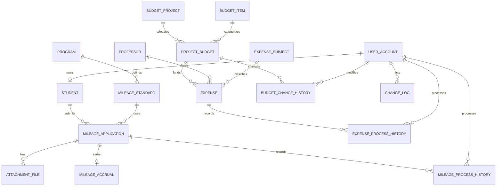

# 마일리지·예산안 및 지출 관리 정책과 설계

작성 기준: PBL1 4팀 보고서의 마일리지·예산 모델을 PBL2 구현 및 SQL 검증 조건에 맞게 보완하였다.
아래 내용은 담당 파트의 **구현 정책 초안**이며 팀 공통 승인 권한과 테이블 구조를 통합할 때 최종 합의한다.
실제 PBL1 발표 피드백은 전달받지 않았으므로 피드백을 반영했다고 기재하지 않는다.

## 1. 역할 정책

| 역할 | 마일리지 | 예산·지출 |
|---|---|---|
| 학생 | 본인 신청, 본인 승인대기 신청 취소, 본인 내역 조회 대상 | 처리 권한 없음 |
| 일반관리자 | 검토·조회 대상, 승인·반려·회수 불가 | 지출 요청 등록 가능, 승인·예산 변경 불가 |
| 마스터관리자 | 승인·반려·대기 취소·전액 회수 | 지출 등록·승인·반려·취소·예산 변경 |

학생 신청 프로시저는 학생과 계정의 연결을 확인한다. 승인/예산 변경은 활성 마스터 계정인지 검사한다.
조회 SQL의 학생 ID 제한은 조회 범위 예시이며 실제 인증된 학생인지 강제하는 장치는 아니다.
현재 패키지의 actor 인수는 호출자가 전달하는 값이다. 다른 학생 데이터 접근과 actor 사칭의 실제 차단은 미구현이며, 별도 로그인 신원 연계·실행 전용 계정·뷰/프로시저 권한 부여가 필요하다.

## 2. 마일리지 정책

1. 프로그램과 부여기준을 분리한다. 기준은 `(프로그램, 참여/입상)` 조합당 하나다.
2. 동일 학생·동일 기준 신청은 전 상태에 걸쳐 한 건만 허용한다. 참여와 입상은 다른 기준이므로 각각 신청할 수 있다.
3. 반려·취소 후 같은 기준으로 다시 신청하는 기능은 이번 구현에서 제공하지 않는다. 재신청을 허용하려면 신청 차수/유효 신청 유일성 정책을 변경해야 한다.
4. 신청 시 기준 점수를 `applied_mileage`에 복사한다. 이후 기준이 바뀌어도 이미 신청한 점수는 변하지 않는다.
5. 마일리지는 0 이상의 정수이며 0점 기준도 허용한다. 음수는 CHECK로 거부한다.
6. 첨부는 신청당 0개 이상 여러 개를 허용한다. 실제 파일은 저장하지 않고 파일명·가상 경로·등록시각만 관리한다. 필수 첨부 여부 심사는 업무 검토로 두며 첨부 없는 신청을 DB가 자동 차단하지는 않는다.
7. 대기에서 승인하면 신청상태·실제 적립·처리이력·공통로그를 한 트랜잭션에 반영한다. 신청 하나당 적립은 UNIQUE로 한 건이다.
8. 회수는 승인 건에 대한 전액 회수만 허용한다. 적립 원본은 보존하고 `REVOKED`로 바꾼다. 부분 회수는 제외한다.
9. 누적값은 저장하지 않는다. 신청 `APPROVED`이면서 적립 `ACTIVE`인 점수만 SUM한다. 학생 전체를 LEFT JOIN하여 미적립 학생도 0점으로 표시한다.
10. 프로그램별 기간 조회는 **최초 승인일 `approved_at`**을 사용한다. 기간은 `[시작일 00:00, 종료일미포함 00:00)`이다.
11. 기간 조회도 현재 유효한 승인 적립을 대상으로 한다. 나중에 회수되면 과거 승인월 조회에서도 제외한다. 특정 과거 시점의 잔액 복원은 별도 이력 집계가 필요하며 현재 제공하지 않는다.

| 현재 | 허용 다음 상태 | 처리자 |
|---|---|---|
| PENDING | APPROVED / REJECTED | 마스터 |
| PENDING | CANCELLED | 본인 또는 마스터 |
| APPROVED | REVOKED | 마스터 |
| REJECTED / CANCELLED / REVOKED | 없음 | 종료 상태 |

이미 승인한 건의 재승인과 NULL/정의되지 않은 상태 전이는 거부한다.
승인자는 최초 승인자로 보존하며 회수 처리자는 처리이력에서 확인한다.

## 3. 예산·지출 정책

1. 항목은 인건비, 학생인건비, 연구장비시설비, 연구활동비, 연구재료비, 연구수당, 간접비 7개 기준정보를 사용한다.
2. 같은 사업·항목의 예산은 한 건만 배정한다. 사업과 항목 간 관계는 `PROJECT_BUDGET`으로 연결한다.
3. `initial_amount`는 최초 편성액, `current_amount`는 변경 후 현재 확정예산, `spending_limit`은 실제 승인 가능한 상한이다. 최초예산은 변경 프로시저에서 수정하지 않는다.
4. 금액은 NUMBER(15,2), 단위 원이다. 예산·한도는 0 이상, 지출은 0 초과다. 한도는 현재 확정예산보다 클 수 없다.
5. 지출주체는 산학협력·전공·융합으로 분류한다. 교수·주체별 별도 배정예산은 없으며 지출 합계만 구분한다.
6. 일반관리자와 마스터는 확정예산에 지출을 대기로 등록한다. 한도 검사는 등록 시점이 아닌 **승인 시점**에 수행한다.
7. 승인 시 기존 승인 지출 합계에 이번 금액을 더해 한도와 비교한다. 같으면 승인, 초과하면 오류로 차단한다. 대기·반려·취소는 합계에 포함하지 않는다.
8. 승인한 지출을 취소할 때 원본을 삭제하지 않고 상태·이력·로그를 남긴다. 승인 지출 금액을 직접 수정하는 기능은 제공하지 않는다. 잘못된 지출은 취소 후 새로 등록한다.
9. 예산 변경 시 현재예산·한도를 함께 검증하며, 새 한도를 기존 승인 합계 미만으로 낮추는 변경은 차단한다.
10. 승인/예산 변경은 같은 사업예산 행을 `SELECT ... FOR UPDATE`로 잠근다. 패키지 호출 간 경쟁을 줄이기 위한 구현이며 2세션 동시 승인 시연은 이번 검증에 포함하지 않는다.
11. 학생인건비는 예산항목으로 구현한다. 학생별·교수별·월별 지급 상세 테이블은 이번 범위에서 제외하고 후속 확장 대상으로 둔다. 확장 시 일반 지출과 지급상세를 연결해 이중 합산을 방지해야 한다.

| 지표 | 산식 |
|---|---|
| 승인 지출 | 현재 APPROVED 지출의 금액 합계 |
| 예산 잔액 | 현재 확정예산 − 승인 지출 |
| 한도 잔여액 | 지출한도 − 승인 지출 |
| 집행률 | 승인 지출 ÷ 현재 확정예산 × 100, 소수 둘째 자리 반올림 |
| 0원 예산 집행률 | 0%로 표시 |

현재예산과 한도가 다를 수 있으므로 예산 잔액과 승인 가능한 한도 잔여액을 별도로 표시한다.
누적지출·잔액·집행률은 상세 지출에서 조회 시 계산하며 저장하지 않는다.

| 현재 | 허용 다음 상태 |
|---|---|
| PENDING | APPROVED / REJECTED / CANCELLED |
| APPROVED | CANCELLED |
| REJECTED / CANCELLED | 없음 |

## 4. PBL1 대비 변경 이력

| 대상 | 기존 보고서 | PBL2 보완 | 이유 |
|---|---|---|---|
| 적립 명칭 | MILEAGE_EARNING / MILEAGE_ACCRUAL 혼용 | MILEAGE_ACCRUAL 통일 | ERD·DDL·조회 일치 |
| 중복 신청 | 추가 확인 필요 | UNIQUE(student_id, standard_id) | 같은 기준 중복 적립 방지 |
| 취소·회수 | 세부 정책 미정 | 대기 취소·승인 전액 회수, 종료 후 재신청 없음 | 상태 전이 명확화 |
| 적립 유효 여부 | 적립 테이블에 명시 상태 없음 | ACTIVE / REVOKED 추가 | 회수 원본 보존과 집계 분리 |
| 예산액 | 최초예산·한도만 존재 | current_amount 추가 | 변경 후 예산과 최초 편성액 구분 |
| 잔액 | 최초예산/한도 기준 혼재 | 현재예산 잔액과 한도 잔여액 분리 | 지표 해석 통일 |
| 지출 처리이력 | 교수 ID 중심, 처리자 누락 | processor_id 사용자 FK와 전후 상태 | 실제 승인·취소한 사람 추적 |
| 상태 기본값 | 제출/승인대기 등 혼용 | PENDING 등 영문 코드 통일 | CHECK·조회·처리 일치 |
| 학생인건비 | 확장 엔터티 제시, 구현 미정 | 예산항목 구현, 지급 상세 확장 보류 | PBL2 핵심 검증에 집중 |
| 공통 구조 | 전체 사용자·역할·학과 설계 | 최소 fixture로 단독 검증 | 통합 완료로 오인하지 않도록 분리 |

## 5. 테이블 정의 요약

정확한 타입·NULL·기본값·제약은 `sql/01_schema.sql`에 기재했다. ID는 양의 값으로 시드하지만 별도 양수 CHECK는 두지 않았다.
신청/지출 ID는 BY DEFAULT ON NULL IDENTITY, 적립·첨부·이력·로그 ID는 ALWAYS IDENTITY를 사용한다.
모든 업무 FK는 삭제/수정 CASCADE를 사용하지 않는다. 참조 중인 부모 삭제와 키 변경은 Oracle FK로 거부된다. 이력은 상태 변경으로 보존한다.

| 테이블 | 키·주요 속성 | 핵심 제약 |
|---|---|---|
| MILEAGE_STANDARD | standard_id, program_id, participation_award_type, grant_mileage | 프로그램+유형 UNIQUE, 점수≥0 |
| MILEAGE_APPLICATION | application_id, student_id, standard_id, applied_mileage, status, approver_id, approved_at | 학생+기준 UNIQUE, 상태 CHECK, 승인자/일시 상태 일관성 |
| ATTACHMENT_FILE | attachment_file_id, application_id, file_name, storage_path, uploaded_at | 신청 FK, 파일명/경로 NOT NULL |
| MILEAGE_ACCRUAL | accrual_id, application_id, earned_mileage, earned_at, status | 신청 UNIQUE, 적립점수≥0, ACTIVE/REVOKED |
| MILEAGE_PROCESS_HISTORY | process_history_id, application_id, old_status, process_status, processor_id, processed_at, process_comment | 신청/사용자 FK, 사유 필수 |
| BUDGET_PROJECT | project_id, business_year, business_round, project_name, start_date, end_date, status | 차수>0, 종료일≥시작일 |
| BUDGET_ITEM | budget_item_id, item_code, item_name, is_active | 코드/항목명 각각 UNIQUE, Y/N |
| PROJECT_BUDGET | project_budget_id, project_id, budget_item_id, initial_amount, current_amount, spending_limit, input_user_id, status | 사업+항목 UNIQUE, 예산/한도≥0, 한도≤현재예산 |
| EXPENSE_SUBJECT | expense_subject_id, subject_name, is_active | 주체명 UNIQUE, Y/N |
| EXPENSE | expense_id, project_budget_id, professor_id, expense_subject_id, input_user_id, expense_date, detail_item, expense_amount, status, processor_id, processed_at | 금액>0, 대기/처리완료 메타데이터 일관성 |
| EXPENSE_PROCESS_HISTORY | history_id, expense_id, old_status, process_status, processor_id, processed_at, reason | 지출/실제 처리 사용자 FK, 사유 필수 |
| BUDGET_CHANGE_HISTORY | change_history_id, project_budget_id, changer_id, old_amount, new_amount, old_limit, new_limit, changed_at, reason | 예산/사용자 FK, 금액 전후/사유 필수 |

선택값은 신청 memo와 아직 승인하지 않은 신청의 승인자/승인시각이다. 그 외 처리 상태별 필수값과 타입은 DDL을 기준으로 한다.
처리이력과 공통로그는 관점이 다르다. 처리이력은 신청/지출별 상태 변화, 공통로그는 업무 유형을 가로지르는 감사 조회에 사용한다.

## 6. 관계도

입력자·승인자 FK는 DDL에 추가로 표현되어 있다. `CHANGE_LOG.target_id`는 대상 유형별 여러 테이블을 가리키므로 범용 FK가 아니며 패키지에서 대상과 함께 기록한다.

## 7. 공통 테이블 통합 계약

| 공통 테이블 | 이 파트가 참조하는 컬럼 | 협업 확인사항 |
|---|---|---|
| USER_ACCOUNT | user_id, role_id, user_type, is_active | `ROLE_PERMISSION`·`PERMISSION.function_code`로 기능권한 검사 후 본인 데이터에는 소유권도 확인 |
| STUDENT | student_id, user_id, student_name, student_no | 학과/학년 등 공통 설계는 담당자 DDL 사용 |
| PROGRAM | program_id, detail_program_name | 만족도 파트와 하나의 프로그램 사용 |
| PROFESSOR | professor_id, name | 교수 PK와 이름 컬럼 통일 |
| CHANGE_LOG | actor_user_id, target_type, target_id, action_type, old_value, new_value, processed_at, reason | ID 기본 생성 방식·전후 값 타입 확인 |

fixture의 PK는 NUMBER(19)다. 실제 공통 테이블도 FK와 호환되는 타입으로 맞춘다.
기준정보 → 신청/사업예산 → 첨부/적립/지출 → 처리·변경이력 순서로 입력한다.

## 8. DB 강제와 구현 한계

- PK/FK/UNIQUE/NOT NULL/CHECK: 잘못된 단일 행 입력을 DB가 직접 차단한다.
- 상태 전이·역할 판단·신청 스냅샷·누적 한도·승인과 로그 원자성: `PBL_WORKFLOW`를 통해 처리한다.
- 패키지는 COMMIT하지 않는다. 내부 실패 시 SAVEPOINT로 해당 호출 변경을 복구하며, 여러 호출로 구성한 업무 전체의 COMMIT/ROLLBACK은 호출자가 결정한다.
- 업무 테이블에 직접 DML하면 패키지 규칙을 우회할 수 있다. 실제 권한 분리와 신원 연계는 미구현이다.
- 예산 한도를 단순 CHECK만으로 구현했다고 설명하지 않는다. 기존 승인 합계와 행 잠금을 이용한다.
- 최초 사업예산 생성과 기준정보 등록은 DDL/시드 경로이며 모든 INSERT를 공통로그로 자동 기록하는 트리거는 없다. 주요 신청·승인·반려·취소·회수·예산 변경은 패키지가 기록한다.
- 날짜는 TIMESTAMP이며 한국 시각(+09:00) 세션으로 실행한다. 시드 승인일은 조회 검증을 위해 10/20으로 고정하고, 처리이력/감사로그는 실제 시드 실행시각을 남긴다. 합성 데이터이므로 두 시각이 동일하지 않다.
- 지출일의 사업기간 포함 여부, 비활성 교수/주체 사용 금지, 증빙의 실제 존재 여부는 자동 검증하지 않는다. 필요하면 팀 통합 정책에 추가한다.
